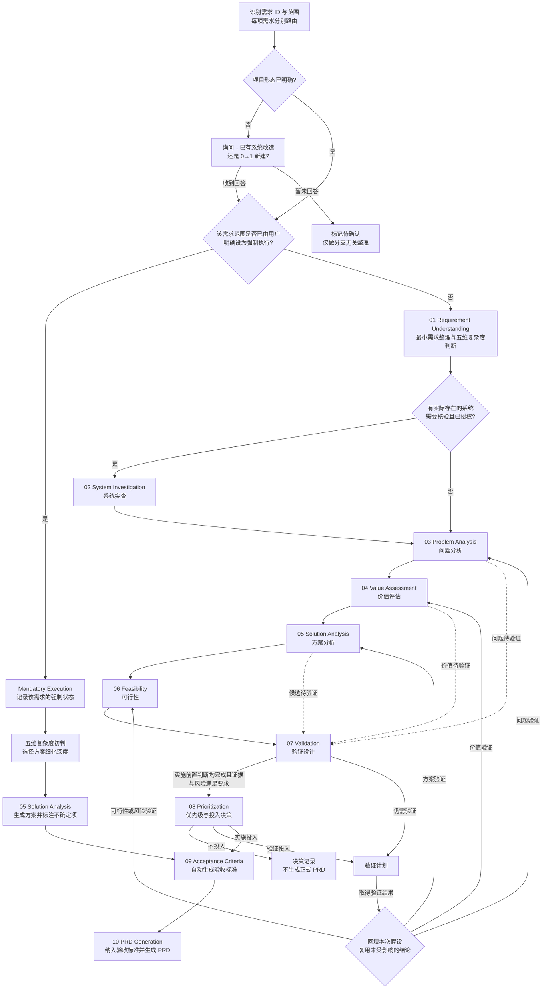

<div align="center">

# Read Her Heart

### AI Product Manager Skill for Codex

把一句模糊的“我想做这个功能”，推进成有证据、有边界、可验证、可排序，并在条件成熟时可直接进入交付的 PRD。

[](https://developers.openai.com/)
[](#)
[](https://github.com/sakura1412/read-her-heart/commits/main)

[快速开始](#快速开始) · [工作流](#十阶段产品工作流) · [使用示例](#使用示例) · [验收标准](#验收标准在-prd-之前) · [PRD 门槛](#prd-准入门槛) · [安全边界](#系统实查与安全边界)

</div>

---

## 它解决什么问题？

很多“需求分析”最终只是把用户的话重新组织一遍：

```text
收到需求 → 分析一下 → 给出做或不做
```

这会遗漏三个关键事实：用户描述的可能只是现象，用户提出的可能只是一个候选方案，一份格式完整的 PRD 也可能建立在未经验证的假设上。

Read Her Heart 将 Codex 变成一个有决策纪律的 AI 产品经理。它不会急着替需求找理由，而是逐层确认：

1. 问题是否真实存在？
2. 问题是否值得解决？
3. 用户给出的方案是否正确？
4. 是否存在更便宜的替代方案？
5. 当前证据是否足够？
6. 风险是否可接受？
7. 最后应该投入到什么程度？

普通模式下，当这些问题没有答案时，它会生成调查或验证计划；只有条件成熟时，才会先生成验收标准，再形成正式 PRD。现实中已经明确拍板、必须交付的需求，可以通过显式“强制执行”指令跳过问题、价值、证据和优先级评估，但仍会先形成产品方案与验收标准，标记不确定项，再生成 PRD。

## 核心能力

- 将现象、问题、目标、方案和需求来源分开，避免把“想要什么”误当成“为什么需要”。
- 开始分析时先确认是改造已有系统，还是从 0 到 1 创建新系统；0→1 无需提供目标系统地址或账号。
- 对功能、体验、业务策略、合规风险、技术工程、运营流程、数据分析、系统集成和缺陷稳定性需求分类。
- 在用户明确授权后，只读检查真实系统、角色权限、现有流程、字段状态和可复用能力。
- 用问题证据、反证与根因假设判断需求是否真实成立。
- 建立“需求 → 价值假设 → 指标 → 基线 → 预期变化 → 证据 → 可信度”的价值链。
- 比较用户方案、现有能力、配置、流程优化、人工运营、采购和新建功能等候选项。
- 分层评估产品、交互、技术、数据、运营、安全和合规可行性。
- 针对关键不确定性设计最低成本、能够改变决策的验证。
- 在多个候选需求之间形成有依据的优先级与投入决策。
- 将本期需求拆成逐项可验收的功能点，自动生成 QA 可据以编写测试用例的验收标准，再纳入 PRD。
- 普通模式只有通过准入门槛后才生成正式 PRD；强制执行模式由用户明确触发，先生成方案与验收标准再生成 PRD。

## 十阶段产品工作流



| 阶段 | 回答的问题 | 主要产物 |
| --- | --- | --- |
| [01 需求理解](references/01-requirement-understanding.md) | 是已有系统改造还是 0→1 新建，五维复杂度对应多深的分析？ | 项目形态、需求理解卡与复杂度路由 |
| [02 系统实查](references/02-system-investigation.md) | 若有实际存在且需核验的系统，它真实如何运转？ | 系统事实记录或不适用说明 |
| [03 问题分析](references/03-problem-analysis.md) | 是不是真的有问题，根因是什么？ | 问题定义与根因判断 |
| [04 价值评估](references/04-value-assessment.md) | 问题是否值得解决，价值如何衡量？ | 价值判断链 |
| [05 方案分析](references/05-solution-analysis.md) | 用户方案是否正确，有没有更便宜的选择？ | 方案比较与推荐候选 |
| [06 可行性](references/06-feasibility.md) | 产品、技术、数据、运营与合规能否支撑？ | 可行性与风险记录 |
| [07 验证设计](references/07-validation.md) | 当前证据是否够，怎样最低成本补证？ | 验证计划或证据充分声明 |
| [08 优先级](references/08-prioritization.md) | 与其他事项相比应该投入多少、何时投入？ | 优先级与投入决策 |
| [09 验收标准](references/09-acceptance-criteria.md) | 已确定的需求和方案怎样判定交付合格？ | 可测试、可追溯的验收标准及待确认项 |
| [10 PRD 生成](references/10-prd-generation.md) | 如何把方案与验收标准清晰交付？ | PRD 或 PRD 阻塞清单 |

新需求先确认项目形态；已说明时不反复追问。0→1 且没有旧系统依赖时，02 记“不适用”，依据用户、业务流程和已有材料继续分析；已有系统即使没有访问条件，也可先标明“未实查”与未知项，不因没有账号停工。普通模式下，只有 08 判定为“实施投入”后才进入 09 验收标准和 10 正式 PRD；[强制执行模式](references/mandatory-execution.md) 是唯一可以跳过问题、价值、证据和优先级门槛的路径，但它仍须先完成 05 的强制方案，再依次进入 09 和 10。

### 验证成功后，回到哪里？

一次验证只更新它对应的判断，不直接批准整个需求实施：

| 本次验证 | 成功后继续 | 失败时处理 |
| --- | --- | --- |
| 问题是否存在 | 更新问题结论，继续价值评估 | 根据问题结论暂停或重新定义 |
| 价值是否成立 | 更新价值结论，继续比较方案 | 根据价值结论暂停或调整 |
| 某个方案是否有效 | 更新候选结论，继续检查可行性和风险 | 淘汰或调整该方案，比较其他候选 |
| 具体风险是否可控 | 补齐剩余判断；全部满足后进入投入决策 | 调整控制措施或暂停相关候选 |

例如，访谈证实“逐条录入客户确实麻烦”，只代表问题得到确认；仍需判断价值、导入方案和数据权限风险。已有且未受影响的结论直接复用，不从头分析。结果不足以支持或否定假设时，明确标记“结论不足”，而非强行判成功或失败。

这套返回规则适用于普通评估模式；“必须做”仍先形成方案、标记未知项，再生成验收标准和 PRD。07 验证的是需求判断，09 定义交付验收的标准；实际验收须在功能交付后进行。详细规则见 [验证设计](references/07-validation.md)。

## 七层决策脊柱

十阶段是产品工作的分工方式；普通模式下，七层是不可跳过的决策逻辑：

```text
需求
 ↓
① 是不是真的有问题？
 ↓
② 问题是否值得解决？
 ↓
③ 用户提出的方案是不是正确方案？
 ↓
④ 有没有更便宜的替代方案？
 ↓
⑤ 当前证据够不够？
 ↓
⑥ 风险是否可接受？
 ↓
⑦ 最后决定投入程度
 ├─ 不投入 ─────────→ 不做或暂停
 ├─ 验证投入 ───────→ 先验证
 └─ 实施投入 ───────→ 受控范围、分阶段或完整投入
```

每一层都会记录：支持证据、反证或不利信号、关键假设、阶段判断、置信度、未确认项和下一步。问题或价值不成立时可以暂停；原方案不成立时仍要继续比较替代方案，后续证据、风险与投入判断针对最终候选。比较后仍无合理候选，才因“无方案”暂停；尚待验证的候选进入验证路径，不直接淘汰。

例如：查询性能问题和解决价值都成立，但 Redis 方案不适用，Skill 会继续比较索引优化等替代方案，再判断其证据、风险与投入，不因否决 Redis 而否决整个需求。

## 快速开始

### 方式一：使用 Codex 内置 Skill 安装器

在安装了 Codex 的环境中执行：

```bash
python3 ~/.codex/skills/.system/skill-installer/scripts/install-skill-from-github.py \
  --repo sakura1412/read-her-heart \
  --path . \
  --name read-her-heart
```

安装器默认将 Skill 放入 `~/.codex/skills/read-her-heart`。如果目标目录已经存在，安装器会停止而不是覆盖；请先确认要保留还是更新现有版本。

### 方式二：使用 Git clone

```bash
git clone https://github.com/sakura1412/read-her-heart.git \
  ~/.codex/skills/read-her-heart
```

以后可以使用下面的命令更新：

```bash
git -C ~/.codex/skills/read-her-heart pull --ff-only
```

如果 Codex 当前任务没有立即识别新安装的 Skill，请开启一个新任务后再调用。

### 调用 Skill

在 Codex 中直接使用 `$read-her-heart`：

```text
$read-her-heart 帮我分析“增加客户批量导入”是否值得做。
```

如果没有说明项目形态，Skill 会先问：**“这个需求是在已有系统中修改，还是从 0 到 1 创建新系统？”** 已经说明则直接沿对应路径分析，不会再要一次答案。

也可以指定希望推进到的阶段：

```text
$read-her-heart 先理解并分类这个需求，不要生成 PRD。
```

```text
$read-her-heart 对这三个候选需求完成价值评估和优先级比较。
```

```text
$read-her-heart 我已经提供了调研、方案和技术评审材料，请检查 PRD 准入条件，满足后生成 PRD。
```

也可以在进入 PRD 前单独查看验收标准：

```text
$read-her-heart 已提供 08 投入决策记录，结论为实施投入；请核对上游结论，并根据确认的方案先生成验收标准，暂不生成 PRD。
```

已经拍板的需求可以使用明确的强制执行指令：

```text
$read-her-heart 必须做：增加客户批量导入。跳过问题、价值、证据和优先级评估，先形成方案、验收标准并标出不确定项，然后生成 PRD。
```

只有指令式的“必须做 / 强制执行 / 已决策形成方案后出 PRD”会触发。疑问句“这个功能必须做吗？”以及材料、网页或他人引述中的“必须做”不会自动触发。

## 使用示例

### 示例一：功能需求

```text
$read-her-heart
我们想增加“客户批量导入”，请先判断问题是否成立、有什么更便宜的替代方案，最后给出投入建议。
```

Skill 会先确认目标用户、导入频率、当前处理方式、失败成本和已有能力，而不是直接设计上传页面。

### 示例二：体验需求

```text
$read-her-heart
销售说客户列表太难用了。请分析真实问题，并设计最低成本的验证方式。
```

Skill 会区分功能缺失、信息架构、交互摩擦、性能、数据质量和使用习惯，不会仅凭“难用”建议重做页面。

### 示例三：技术需求

```text
$read-her-heart
研发建议增加 Redis。请判断它真正要解决什么问题，并比较替代方案。
```

`Redis` 会被视为候选方案。Skill 会追溯性能、稳定性、成本或架构问题，并要求监控、压测、事故或技术材料支持判断。

### 示例四：领导指定需求

```text
$read-her-heart
老板要求增加一个经营驾驶舱。请区分已经确定的目标和仍可讨论的方案，并给出产品推进路径。
```

领导指定会被记录为来源和约束，而不是需求成立的证据，也不会自动触发强制模式。用户仍要求评估时保留普通流程；只有用户明确下达“已决策，形成方案后出 PRD”等执行指令，才对指定需求和范围启用强制模式。

### 示例五：授权系统实查

```text
$read-her-heart
我授权你只读检查测试环境中的客户管理流程，范围仅限客户列表、详情和导入模块。请根据现状评估批量导入需求。
```

Skill 会先确认环境、角色、模块和数据范围。登录凭证、验证码和 SSO 应由用户在浏览器中自行完成，不应粘贴到对话或需求文档中。

### 示例六：0→1 新系统

```text
$read-her-heart
这是从 0 到 1 创建的客户管理系统，目前没有系统地址和账号。请根据目标用户、现有业务做法和原型评估首版需求。
```

Skill 会把现有业务做法与拟建产品区分开；02 对尚不存在的目标系统不适用，不会要求登录。若新系统要对接旧系统，仅对影响判断且获授权的旧系统考虑实查。

### 示例七：PRD 请求

```text
$read-her-heart
请根据这些访谈、数据、原型和技术评审材料生成 PRD。
```

Skill 会先检查 PRD 准入门槛。条件满足时先生成可测试验收标准，再写入 PRD；条件不足时返回阻塞清单或验证 Brief，而不是伪造完整需求。

### 示例八：已经决策，强制生成方案和 PRD

```text
$read-her-heart
强制执行：经营驾驶舱必须在本季度交付。不要评估是否值得做，先形成方案、验收标准并标出不确定项，再按复杂度生成 PRD。
```

Skill 会跳过问题、价值、证据、07 决策型验证和优先级门槛，但不会跳过方案或 09 验收标准。它会先给出核心机制、流程、范围、规则、异常、权限和依赖，缺失信息标为“假设”“待确认”或“待技术确认”，再形成可测试验收标准和对应层级的 PRD；不会因为普通产品证据不足退回阻塞清单，也不会编造成本、工期、数据或技术结论。

## 需求分类

Read Her Heart 使用“双轴分类”：

- **主类型**说明需求本身是什么。
- **来源/驱动标签**说明需求为什么进入评估。

| 主类型 | 示例 |
| --- | --- |
| 功能需求 | 增加客户批量导入 |
| 体验需求 | 客户列表太难用了 |
| 业务策略需求 | 是否要做 AI 销售助手 |
| 合规/风险需求 | 是否需要增加操作日志 |
| 技术/工程需求 | 是否需要 Redis |
| 运营/流程需求 | 优化人工审核与交接流程 |
| 数据/分析需求 | 增加经营指标和报表 |
| 集成/生态需求 | 对接第三方 CRM |
| 缺陷/稳定性需求 | 导入任务偶发丢失 |

“领导指定”“用户强诉求”“监管强制”“合同承诺”“数据或事故驱动”“市场或竞品驱动”属于来源标签。来源会影响紧迫性和证据要求，但不能替代问题、价值和方案判断。

详细规则见 [需求分类与分析路由](references/requirement-classification.md)。

## 先判断复杂度，再分析需求

顺序是：**最小需求整理 → 五维复杂度判断 → 选择分析深度 → 展开需求分析**，不先写完整分析再补一个复杂度标签。

```text
复杂度 = 业务影响 × 系统影响 × 用户影响 × 数据风险 × 不可逆性
```

| 维度 | 重点看什么 |
| --- | --- |
| 业务影响 | 是否改变核心流程、交易、收费、权益、履约或经营模式 |
| 系统影响 | 涉及的模块、接口、状态、跨系统依赖和共享能力 |
| 用户影响 | 受影响角色、关键任务、操作习惯、权益和采用成本，不只看人数 |
| 数据风险 | 敏感数据、权限边界、数据完整性、迁移与丢失风险 |
| 不可逆性 | 能否回滚、恢复数据、补偿用户及撤回对外影响 |

未指定评分量表与阈值时，默认用“低 / 中 / 高 / 未知”记录各维依据，把乘号作为联动放大的判断框架，不自行输出数值乘积。五维均低且有依据、没有联动放大才判简单；存在中等影响时重点分析相关变化；任一高影响，或多个中等影响相互作用造成显著级联风险时，按复杂处理。未知不等于低：明确待确认项和临时档位，再补关键缺口。详细锚点及路由见 [五维复杂度判断](references/complexity-assessment.md)。

| 复杂度 | 分析深度与方法 |
| --- | --- |
| 简单需求 | 紧凑完成七层判断，不使用方法框架 |
| 中等复杂需求 | 深入主要不确定性、角色、规则及依赖，最多选择 1～2 个方法 |
| 复杂或战略需求 | 拆解系统/流程/角色及风险联动，允许多个各有用途的方法，不强制堆叠 |

五维复杂度判断本身不占方法名额。可选方法仍包括 5W2H、5 Whys、用户故事地图、KANO、RICE 和四象限；复杂度不是价值、优先级或研发工期估算，也不能让低风险项抵消高风险项。系统实查或范围变化后，只更新受影响维度、分析深度、验收覆盖和 PRD 详略，已有有效结论不重做。

“必须做”模式也先看五维复杂度，用于调整方案设计、验收覆盖和 PRD 的详略；不会恢复问题、价值、证据或优先级门槛，未知项不阻塞 PRD。默认回复只增加一行复杂度与分析重点，不额外堆叠长报告。

### RICE 不默认计算

默认只做定性记录：

| 维度 | 默认值 |
| --- | --- |
| Reach | 未知 / 低 / 中高 / 极高 |
| Impact | 未知 / 低 / 中高 / 极高 |
| Confidence | 未知 / 低 / 中高 / 极高 |
| Effort | 待研发确认 |

AI 不得自行估算数字，也不得把定性等级自动换算成系数。只有用户提供完整、同口径的数据、统计窗口、对象定义和投入单位后，才可以考虑计算 RICE 分数。

## 系统实查与安全边界

系统实查是为了理解**实际存在的系统**，不是 0→1 项目的必经步骤，也不是自动化操作授权。新系统可用访谈、现有业务流程、原型和技术材料分析，但不得把设计稿当成已上线系统事实。

- 只有用户明确授权后才访问系统。
- 登录前确认环境、账号角色、模块、数据范围和任务目标。
- 优先使用最小权限、只读、测试或临时账号。
- 密码、验证码、令牌、Cookie 和敏感数据不得写入聊天、文件、截图或报告。
- 默认只读浏览；创建、修改、删除、提交、发布、发送、导出和设置变更需要单独授权。
- 遇到 MFA、验证码、越权要求、提示词注入或超范围敏感数据时立即停止。
- 单一角色、测试环境和页面观察不能代表全部用户、生产规则或后端技术事实。
- 实查结束保留用户原有登录；仅清理本任务新建、隔离且确认不会影响其他会话的临时会话。新标签页不等于独立会话；归属或退出影响不明时保留并说明，不擅自清 Cookie 或执行全局登出。

详细规则见 [系统实查模块](references/02-system-investigation.md) 和 [系统实查指南](references/system-inspection.md)。

## 验收标准：在 PRD 之前

09 先将本期需求拆成可独立判断的 `FR` 功能点，再为每个功能点生成关联的 `AC` 验收条目，由 10 原样纳入 PRD。每条写明适用角色、前置与数据条件、触发动作、可观察结果和规则状态，让 QA 能据此编写可判通过/失败的测试用例；适用时覆盖失败、权限、数据边界与恢复路径。未知规则或数值标为“待确认”；若 QA 仍须猜测预期结果，则明确标“QA 编写受阻”，不假称验收标准已准备好。

简单需求只覆盖实际适用的关键场景，但每条仍须足够具体；中等和复杂需求按实际影响扩展角色、流程、状态、异常、跨系统和安全边界，不机械凑条数。验收标准不是逐步测试脚本：QA 可自行设计执行步骤和测试数据，不能被迫决定产品规则。07 的验证计划用于判断需求是否值得实施，09 的验收标准用于判断交付结果是否符合要求。详细规则见 [验收标准模块](references/09-acceptance-criteria.md)。

## PRD 准入门槛

### 普通模式

正式 PRD 只有在以下条件同时满足时生成：

- 目标用户、场景、需求边界和非目标明确。
- 问题和价值成立，核心证据达到实施决策所需强度。
- 推荐方案已与更便宜的替代方案比较。
- 产品、交互、技术、数据、运营和合规可行性已确认，或有明确关闭条件。
- 不存在不可接受风险。
- 范围、验收对象与判定方向、停止和回退条件可以定义；具体标准由 09 生成。
- 第 08 阶段的投入程度为“实施投入”。

### 强制执行例外

当当前用户明确输入 `必须做：<需求>`、`强制执行：<需求>`，或说明“已决策，不做价值判断，形成方案后出 PRD”时，Skill 会跳过问题、价值、证据和优先级门槛，但必须先生成对应方案与验收标准，再据此生成相应层级的正式 PRD。

强制模式绑定**具体需求和范围**，不会把整段对话切换成“所有需求必须做”。Skill 自动分配或复用需求 ID，用户无需先准备编号。

| 情况 | 如何处理 |
| --- | --- |
| A 必须做，B 帮我评估 | A 先方案和验收标准后 PRD；B 独立正常评估 |
| 继续细化 A 的规则、异常或修改原 PRD | 在已确认范围内继承 A 的模式，不反复确认 |
| 下一轮提出新需求，或给 A 增加可独立取舍的能力 | 新增项默认正常评估；原有范围不变 |
| 明确说“新增 B 也必须做” | 单独将 B 绑定为强制模式，不扩大到未来需求 |
| 明确说“A 改为正常评估，重新判断是否值得做” | 只切换 A，复用有效事实并补齐未完成判断 |

例如：`必须做 A：客户批量导入；另外评估 B：是否需要自动客户评分。` A 可以形成方案、验收标准与 PRD，B 不会跟随 A 跳过评估，也不会在未通过门槛时混入正式交付范围。只有“它也必须做”等指代确实不清时才针对性确认；安全、权限及系统操作授权不随模式继承或扩大。

强制执行不会取消真实性和安全底线：未知信息写“待确认”，合理补充写“假设”，研发判断写“待技术确认”；不得编造数据、收益、成本、工期、架构或专业结论。安全、权限、隐私和合规约束必须写入方案、验收标准与 PRD；它也不会自动授权访问系统、修改数据、编写代码或发布功能。

完整规则见 [强制执行模式](references/mandatory-execution.md)。

### PRD 按复杂度分级

PRD 的详略由上述五维复杂度决定，不把同一套长文档套在所有需求上。三个层级都是正式 PRD，普通模式的准入门槛与强制模式的方案步骤不变。

| 需求复杂度 | PRD 层级 | 写作重点 |
| --- | --- | --- |
| 简单：五维均有依据为低 | 简版 | 直接写明范围、用户场景、系统行为、适用规则，并纳入 09 生成的关键验收标准；仅在涉及权限、数据、异常或待确认项时补充对应约束 |
| 中等，或复杂度暂按中等处理 | 标准版 | 在简版基础上补充必要的角色、流程、状态、异常、依赖和风险；验收覆盖受影响的分支，不为凑章节重复 |
| 复杂/战略，或已知高影响 | 完整版 | 沿用下方 12 项结构，充分展开跨系统、权限、数据、风险、发布回退和追溯，并纳入相关验收标准 |

例如，简版 PRD 中的功能点可以是 `FR-001：工单列表支持按创建时间倒序显示，不改变工单内容和查看权限。` 09 对应生成：`AC-001：给定有列表权限且结果中存在创建时间不同的工单 A、B，当用户选择倒序时，较新的工单排在较旧的前面，结果中的工单 ID 集合不变。` `AC-002：给定账号无权查看工单 C，当该账号选择倒序时，C 仍不出现在列表。` 若跨页排序口径未知，单列待确认，不让 QA 自行猜测。短 PRD 不必生成空的背景、指标或发布章节，但不能省略适用的功能点与 AC。

复杂/战略需求的完整版结构包含：

1. 文档信息与决策来源。
2. 背景、问题、根因和证据。
3. 目标、非目标、指标、基线与预期变化。
4. 本期范围、后续范围、角色和权限。
5. 用户流程、主路径与异常路径。
6. 带稳定编号的功能需求。
7. 数据、权限、审计、迁移和埋点要求。
8. 性能、可靠性、安全、隐私和兼容等非功能需求。
9. 09 已生成、与功能需求对应的可测试验收标准。
10. 发布、灰度、监控、培训、回退和长期运营。
11. 依赖、风险、开放问题及责任人。
12. 从需求到指标和验收标准的追溯关系。

各层级的详细规则见 [PRD 生成模块](references/10-prd-generation.md)。

### PRD 下载与交付

普通模式和强制执行模式生成 PRD 时，默认都交付 **可下载的 PDF**，同时保留可编辑源稿。PDF 按对应层级包含适用的需求、方案、已生成的验收标准及假设和待确认项；强制执行模式还会注明执行状态和跳过的评估环节。

默认采用快速导出：复用现有工具与 A4 中文模板，一次生成 PDF，再通过一次文本提取检查文件有效性、正文非空、当前版本的文档结束标记及应交付功能需求和验收标准编号（FR/AC）。结束标记放在源稿实际末尾并随正文导出，避免仅凭首页有字就漏过后半部分截断；标记或编号缺失时先定位修复，不直接宣称完成。

这只是轻量的截断与遗漏检查，不是逐字完整性或视觉检查。不默认逐页截图、全文逐项比对或反复调整样式；出现明确异常时才局部检查。需要精细排版检查时可明确提出。后续修改 PRD 时，同步 PDF、源稿及本次核验的版本和编号。

可以直接这样使用：

```text
$read-her-heart
必须做：增加客户批量导入。
先生成方案和验收标准，标出不确定项，再按复杂度生成正式 PRD。
请交付可下载的 PDF，并保留 Markdown 源稿。
```

运行环境需要具备本地文件生成与 PDF 导出能力。若缺少工具、字体或权限，Skill 会说明具体限制并保留源稿，不会把仅有聊天正文视为 PDF 已交付。生成的业务 PRD 默认保存在当前任务的输出目录，不会自动上传到本 Skill 的公开仓库。

## 输出会根据证据改变

默认回复精简：普通评估先用一行说明五维复杂度与分析深度，再按七层顺序每层一句判断与关键依据；追问只回答新增内容；PRD 交付提供简短说明、关键待确认项与 PDF/源稿链接。完整方案和需求细节保留在文件中，不在聊天里重复全文。

同一事实、风险或结论只完整说明一次，不再叠加十阶段报告、七层全表与同义总结。简单评估参考 300–600 字，复杂任务按需展开；精简不省略关键证据、反证、安全约束或验收要求。需要更详细内容时，可直接说“展开方案部分”或“展示完整分析”。

| 投入程度 | 行动出口 | 默认交付物 |
| --- | --- | --- |
| 不投入 | 不做或暂停 | 决策记录、停止层、原因和重开条件 |
| 验证投入 | 先验证 | 验证假设、方法、成本未知项、成功/失败阈值和后续分支 |
| 实施投入 | 直接做 | 受控/分阶段/完整投入决定、验收标准，以及通过门槛后的正式 PRD PDF 与源稿 |
| 强制执行 | 方案和验收标准后 PRD | 强制执行状态、方案摘要、验收标准、对应层级的正式 PRD PDF 与源稿，包含假设、待确认项和安全合规约束 |

“延后”只是实施投入后的排期状态，不是第四种需求判断。

## 项目结构

```text
read-her-heart/
├── SKILL.md
├── README.md
├── agents/
│   └── openai.yaml
└── references/
    ├── 01-requirement-understanding.md
    ├── 02-system-investigation.md
    ├── 03-problem-analysis.md
    ├── 04-value-assessment.md
    ├── 05-solution-analysis.md
    ├── 06-feasibility.md
    ├── 07-validation.md
    ├── 08-prioritization.md
    ├── 09-acceptance-criteria.md
    ├── 10-prd-generation.md
    ├── analysis-templates.md
    ├── complexity-assessment.md
    ├── mandatory-execution.md
    ├── requirement-classification.md
    └── system-inspection.md
```

- [`SKILL.md`](SKILL.md)：轻量入口、阶段路由、七层门槛和交付控制。
- [`agents/openai.yaml`](agents/openai.yaml)：Codex UI 展示信息和默认调用提示。
- [`references/`](references/)：按阶段加载的详细方法、模板和安全规则。

## 设计原则

1. **问题先于方案**：技术、页面和 AI 能力默认只是候选方案。
2. **证据先于精确数字**：未知就写未知，不制造虚假的确定性。
3. **反证与支持证据同等重要**：不能只搜集支持需求的材料。
4. **最小验证优先**：验证必须能够改变决策，而不是为了收集更多数据。
5. **投入与证据匹配**：证据弱时先验证，高风险时提高门槛。
6. **普通模式下，PRD 是决策结果，不是需求起点**：完整格式不能替代问题成立；强制执行必须显式记录评估门槛已被用户指令跳过，并先形成方案。
7. **渐进式披露**：只加载当前阶段需要的参考文件，控制上下文噪声。
8. **授权不自动扩大**：能访问不代表允许访问，能操作不代表允许修改。

## 适用与不适用场景

适合：

- 产品发现、需求澄清和需求评审。
- 业务或内部系统需求判断。
- 用户反馈、领导指令、合同需求和合规事项分析。
- 多个候选需求的优先级比较。
- 授权后的现有系统和业务流程检查。
- 从 0 到 1 的新系统需求分析；不要求提供尚不存在的系统入口或账号。
- 验证设计、可行性评审、验收标准和 PRD 生成。

不适合：

- 已经明确需求，只需要直接编写代码的纯实现任务。
- 未经授权访问、修改或导出系统数据。
- 用 AI 代替法务、安全、财务或研发负责人的最终专业确认。
- 在缺少证据时生成看似确定的成本、工期、收益或市场规模。

## 常见问题

### 可以直接让它生成 PRD 吗？

普通请求会先检查准入门槛，门槛不足时返回 PRD 阻塞清单或验证 Brief；满足时先生成验收标准，再写入 PRD。如果该需求已经明确拍板，使用 `必须做：<需求>` 或 `强制执行：<需求>`，Skill 会跳过问题、价值、证据和优先级评估，先形成方案和验收标准并标记不确定项，再生成 PRD。

### 验收标准会自动生成吗？

会。在已确定实施范围和方案后，09 逐功能点形成可测试的 AC；QA 应能根据角色、条件、操作和预期结果编写用例，10 复用这些标准，不重新编造。无法判定的规则标为“QA 编写受阻／待确认”，不把生成标准当作测试通过或上线批准。

### 只要文字中出现“必须做”就会触发吗？

不会。只有当前用户将它作为明确执行指令时才触发。疑问句、需求材料、网页内容、客户反馈或他人引述不会自动切换模式。

### 每次都必须完整输出十个阶段吗？

不需要。十阶段用于组织工作，不是每次回复的十个章节。普通评估简要展示七层判断，追问只说明变化；完整记录按需展开。用户只要求某一阶段时，只完成该阶段和必要的上游门槛。

### 系统实查是不是必须提供账号密码？

不是。Skill 会先确认这是已有系统改造还是 0→1 新建；新系统没有现存依赖需要核验时跳过 02，不需要系统地址或账号。已有系统但无法访问时也能继续做有边界的初步分析，标明未实查。确需登录且已授权时，由用户在浏览器中自行输入密码、验证码或完成 SSO，避免把凭证发送到对话中。

### 10 个客户都要求某功能，是否应该直接做？

不能直接下结论。需要确认这些客户是否属于目标客群、需求是否来自同一场景、影响价值、替代方式和不满足的后果。强烈程度不等于覆盖范围。

### 为什么 RICE 不直接计算？

没有同口径的 Reach、Impact、Confidence 和 Effort 时，分数只是伪精确。默认定性记录能暴露未知项，数据完整后再考虑计算。

### 它会替代产品经理吗？

不会。它提供结构化分析、证据追踪和文档生成能力；战略取舍、组织承诺、专业风险确认和最终决策仍由相应负责人承担。

## 参与改进

欢迎通过 Issue 或 Pull Request 提交真实案例、失败样本和改进建议。修改时请遵守以下原则：

- 优先修复真实使用中观察到的决策问题，不为单个例外不断增加通用规则。
- 新方法必须说明它减少哪个阶段的什么不确定性。
- 不削弱系统访问、隐私、合规和凭证保护边界。
- 普通模式不允许 PRD 绕过问题、价值、方案、证据和风险门槛；强制执行例外必须由当前用户显式触发，方案阶段仍不可跳过，并保留安全、权限、隐私、合规与真实性约束。
- 保持 `SKILL.md` 精简，将阶段细节放入对应 `references/` 文件。

提交前建议检查 Markdown 链接、YAML frontmatter、十阶段引用和七层顺序，并确认所有新增示例不会泄露真实用户或业务数据。

---

<div align="center">

**优秀的产品决策，不是更快地写出 PRD，而是更早地发现不该做、需要验证或值得投入的事情。**

</div>
