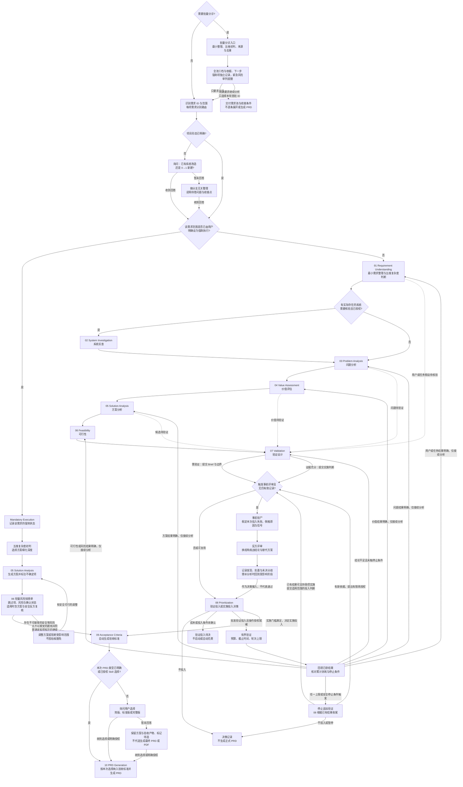

<div align="center">

# Read Her Heart

### AI Product Manager Skill for Codex · WorkBuddy · Claude Code

把一句模糊的“我想做这个功能”，推进成有证据、有边界、可验证、可排序，并在条件成熟时可直接进入交付的 PRD。

[](SKILL.md)
[](#快速开始)
[](#)
[](https://github.com/sakura1412/read-her-heart/commits/main)

[快速开始](#快速开始) · [问答式澄清](#问答式澄清与续接) · [工作流](#十阶段产品工作流) · [事前评审](#事前验尸与反方评审) · [证据台账](#统一证据台账) · [需求变更](#需求变更与多轮冲突) · [批量需求](#批量需求与需求池) · [跨会话需求库](#跨会话需求库与-backlog) · [完整案例与评测](#完整案例与回归评测) · [输出模板](#可复用输出模板) · [外部扫描](#可选外部扫描) · [市场与用户研究](#市场竞品与用户研究) · [验收标准](#验收标准在-prd-之前) · [PRD 门槛](#prd-准入门槛) · [安全边界](#系统实查与安全边界)

</div>

---

## 它解决什么问题？

很多“需求分析”最终只是把用户的话重新组织一遍：

```text
收到需求 → 分析一下 → 给出做或不做
```

这会遗漏三个关键事实：用户描述的可能只是现象，用户提出的可能只是一个候选方案，一份格式完整的 PRD 也可能建立在未经验证的假设上。

Read Her Heart 为 Codex、WorkBuddy 和 Claude Code 提供同一套有决策纪律的 AI 产品经理工作流。核心是带 YAML 元数据的 `SKILL.md` 与配套参考资料、模板和脚本；安装与调用入口随宿主不同。它不会急着替需求找理由，而是逐层确认：

1. 问题是否真实存在？
2. 问题是否值得解决？
3. 用户给出的方案是否正确？
4. 是否存在更便宜的替代方案？
5. 当前证据是否足够？
6. 风险是否可接受？
7. 最后应该投入到什么程度？

普通模式下，当这些问题没有答案时，它会生成调查或待投入决策的验证计划；只有条件成熟时，才会先生成验收标准，再形成正式 PRD。现实中已经明确拍板、必须交付的需求，可以通过显式“强制执行”指令跳过问题、价值、证据和优先级评估，但仍须依次形成产品方案、轻量风险知情单与验收标准，再生成 PRD。

## 核心能力

- 将现象、问题、目标、方案和需求来源分开，避免把“想要什么”误当成“为什么需要”。
- 开始分析时先确认是改造已有系统，还是从 0 到 1 创建新系统；0→1 无需提供目标系统地址或账号。
- 对功能、体验、业务策略、合规风险、技术工程、运营流程、数据分析、系统集成和缺陷稳定性需求分类。
- 在用户明确授权后，只读检查真实系统、角色权限、现有流程、字段状态和可复用能力。
- 用统一证据台账记录来源、时间、强度、偏差与支持/反证关系；以稳定编号连接假设、验证判据、决策和 PRD，不只保留支持需求的材料。
- 建立“需求 → 价值假设 → 指标 → 基线 → 预期变化 → 证据 → 可信度”的价值链。
- 比较用户方案、现有能力、配置、流程优化、人工运营、采购和新建功能等候选项。
- 经用户授权，在影响判断时快速核查竞品功能、市场/监管变化，并结构化比较采购与自建。
- 支持 0→1 的市场与用户取证：按任务建立竞品对标表，按需选择用户画像或 JTBD，并对市场证据分级；无用户材料时保留假设，不虚构研究结论。
- 分层评估产品、交互、技术、数据、运营、安全和合规可行性。
- 由 07 设计能改变决策的最小验证，08 单独判断验证成本是否值得；按预算、截止时间和轮次上限停止，避免无限补证。
- 复杂/战略或不可逆需求在 08 前做事前验尸与反方评审，记录重要反对意见及处置；简单需求不增加固定评审负担。
- 面对成批候选需求，先按最小信息、五维复杂度和来源标签分诊，合并真重复，分成“直接不投入 / 需验证 / 值得深入”，只对选中的首批继续分析。
- 按需把分析状态保存为项目私有目录中的结构化需求卡，跨会话按同一目录读取，并生成简洁 Backlog 视图。
- 对已存在需求逐次分析变更：联动范围、`FR`、`AC`、指标与验收覆盖，检查关联功能及历史/并行冲突；PRD 内保留影响与变更记录，只更新受影响部分。
- 比较既有 PRD 与新增诉求，按“作废 / 修改 / 新增”输出 Delta PRD 增量说明，保留不变规则与原编号，不用全文重写掩盖变化。
- 复杂状态流转或多角色/系统协作难以用文字说清时，自动补充 Mermaid 状态图或时序图，与规则和验收编号对应；简单需求不强行配图。
- 在多个候选需求之间形成有依据的优先级与投入决策。
- 将本期需求拆成逐项可验收的功能点，自动生成 QA 可据以编写测试用例的验收标准，再纳入 PRD。
- 生成 PRD 前请用户选择简版、标准版或完整版；复杂度用于分析与必要覆盖，只给建议，不自动替用户定档。
- 普通模式只有通过准入门槛后才生成正式 PRD；强制执行模式由用户明确触发，先生成方案、风险知情单与验收标准，再生成 PRD；“必须做”不等于接受所有风险。

## 问答式澄清与续接

遇到会改变分析路径、方案或验收口径的关键歧义时，Skill 先看上下文能否确定答案；仍不清楚才聚焦一个问题，给两个简短、可区分的建议选项，并保留“其他”自由输入。例如：

> 这个需求属于哪种项目形态？
>
> ① 改造已有系统　② 从 0 到 1 新建　其他：请自行输入（例如新建系统并对接旧系统）

如果当前宿主提供结构化提问界面，就优先使用其选项与自由输入能力；若没有，则以以上文本方式提问。**Skill 本身不能保证界面一定显示按钮或输入框。**用户可以选择建议项，也可以输入不同答案；预选项、未回复和推测都不算确认。具体规则见[问答式澄清与续接](references/clarification-dialogue.md)。

提问后，Skill 会先完成不依赖答案的整理；需要该答案才能判断的部分保持“待决”，不在后台无限等待，也不越过门槛。你在同一对话回复后，它根据实际答案从受影响的最早判断继续；如果暂时没有回复，就给出已完成部分、待答问题和续接点，不会把沉默当成默认选项。密码、授权和安全审批仍使用各自的安全机制，不能用普通选项题替代。

## 十阶段产品工作流



结果回填与停止检查分别执行：上限已到仍可用已有证据继续分析，但不能新增取证；若后续分析再次提出验证，仍受原累计限制与 08 的有限投入决定约束。事前评审是 07 与 08 之间的条件分支，不新增固定阶段；停止追加验证或采取安全措施不等评审，新验证或受控实施的投入判断则须完成适用评审或复用仍有效记录。

| 阶段 | 回答的问题 | 主要产物 |
| --- | --- | --- |
| [01 需求理解](references/01-requirement-understanding.md) | 是已有系统改造还是 0→1 新建，五维复杂度对应多深的分析？ | 项目形态、需求理解卡与复杂度路由 |
| [02 系统实查](references/02-system-investigation.md) | 若有实际存在且需核验的系统，它真实如何运转？ | 系统事实记录或不适用说明 |
| [03 问题分析](references/03-problem-analysis.md) | 是不是真的有问题，根因是什么？ | 问题定义与根因判断 |
| [04 价值评估](references/04-value-assessment.md) | 问题是否值得解决，价值如何衡量？外部趋势或监管变化是否影响价值？ | 价值判断链；必要且获授权时补充外部证据 |
| [05 方案分析](references/05-solution-analysis.md) | 用户方案是否正确，有没有更便宜的选择？采购、自建或复用如何取舍？ | 方案比较与推荐候选；必要且获授权时补充竞品/替代品对比 |
| [06 可行性](references/06-feasibility.md) | 产品、技术、数据、运营与合规能否支撑？ | 普通模式：可行性与风险记录；强制模式：轻量风险知情单 |
| [07 验证设计](references/07-validation.md) | 哪些假设仍需验证，怎样以最小方法获得有用结论？ | 引用同版台账 E/H 的验证 Brief 与判据，或证据充分说明；不批准花费 |
| [08 优先级](references/08-prioritization.md) | 这笔验证成本是否值得花？实施条件成熟后，应投入多少、如何排序？ | 承接适用评审后，形成验证投入决定及边界，或实施优先级与投入决定；两类决定分开 |
| [09 验收标准](references/09-acceptance-criteria.md) | 已确定的本期功能点怎样判定交付合格？ | 可测试、可追溯的功能验收条件及待确认项 |
| [10 PRD 生成](references/10-prd-generation.md) | 用户选择哪种 PRD，如何把方案与验收标准清晰交付？ | 按已确认类型生成的 PRD，或待选/阻塞说明 |

新需求先确认项目形态；已说明时不反复追问。0→1 且没有旧系统依赖时，02 记“不适用”，依据用户、业务流程和已有材料继续分析；已有系统即使没有访问条件，也可先标明“未实查”与未知项，不因没有账号停工。普通模式下，只有 08 判定为“实施投入”后才进入 09 验收标准和 10 正式 PRD；[强制执行模式](references/mandatory-execution.md) 是唯一可以跳过问题、价值、证据和优先级门槛的路径，但仍按 **05 方案 → 06 轻量风险知情单 → 09 验收标准 → 10 PRD** 交付，不恢复 03/04/07/08 的产品决策门槛。

两种模式都在生成 PRD 前确认本次交付类型；用户已选或明确授权 Skill 选择时不重复询问。这是[交付偏好](#prd-类型由用户选择)，不是新增的产品价值门槛。

### 07 设计验证，08 决定是否投入

**07 回答“验证什么、怎么验证”，08 回答“这笔验证值不值得花”。** 07 识别会改变决策的假设、设计最小方法、预先写明支持/不支持/结论不足的判据，产出待决的验证 Brief；它不自行批准预算或启动实验。08 比较信息价值、做错损失、验证成本、时间窗口和替代取证方式，再决定是否投入。

Brief 直接引用[证据台账](#统一证据台账)版本、已有 `E` 编号与对应 `H` 假设，指出哪些证据有效、哪些不足，以及判据所需的范围、质量和口径。**不默认“满 3 条”或“强度为强”就通过**，缺失的阈值保留待确认；计划收集的材料不能提前登记为已获得的证据。实际结果先入账，再按原判据回填假设与来源阶段；改变判据须说明原因并保留原版本，不能看完结果后悄悄降低门槛。

08 因此有两类入口：实施前置判断尚未满足时，也可以只审查一项验证方案，但不能据此把问题、价值或实施门槛写成已通过；只有实施所需判断全部满足，才作实施投入决定。07 的计划不值得花费时由 08 选择不投入/暂停；估算、预算边界或决策来源缺失时标“待决”，不是假定已批准。即使投入获批，访问、招募、发送、实验或改系统仍须各自授权。

验证 Brief 先记录 **预算上限（含人时等非现金资源）、截止时间、轮次上限、累计已耗、负责人及决定来源**。无依据的金额、日期和工作量写待确认；用户/项目已确认的限制优先，未指定轮次时提出“最多 2 轮”的建议，执行前需确认，不把建议视为用户已批准的额度。只请求方案时可以交付待确认 Brief，不因此启动实际验证，也不把读取现有获授权材料变成额外审批流程。

### 验证结果如何回填和停止？

一次验证只更新它对应的判断，不直接批准整个需求实施：

| 本次验证 | 支持假设后继续 | 不支持假设时处理 |
| --- | --- | --- |
| 目标人群、任务或替代路径 | 更新01理解卡，继续未完成的02/03；不代表问题成立 | 修正目标人群/任务假设，保留反例，不自动否定其他人群 |
| 问题是否存在 | 更新问题结论，继续价值评估 | 根据问题结论暂停或重新定义 |
| 价值是否成立 | 更新价值结论，继续比较方案 | 根据价值结论暂停或调整 |
| 某个方案是否有效 | 更新候选结论，继续检查可行性和风险 | 淘汰或调整该方案，比较其他候选 |
| 具体风险是否可控 | 补齐剩余判断；全部满足后进入投入决策 | 调整控制措施或暂停相关候选 |

例如，访谈证实“逐条录入客户确实麻烦”，只代表问题得到确认；仍需判断价值、导入方案和数据权限风险。已有且未受影响的结论直接复用，不从头分析。结果不足以支持或否定假设时，明确标记“结论不足”，不强行作出判断，也不直接追加下一轮。

**预算、截止时间、轮次上限任一先到，或安全停止条件触发，就停止新增验证。** 每轮回填实际消耗和结果，再判断是否仍在批准范围内；剩余额度不等于下一轮自动获准，明确的多轮批准仅在原范围、条件和余量仍有效时沿用。停止的是新增取证与资源承诺，已有结果仍回填来源判断，未受影响的分析可继续。08 根据已有结果收尾，不因“已经花了不少”继续投入，也不通过换验证 ID、换名称或换会话清零同一决策问题的累计历史。

如果已批准最多两轮，两轮后仍结论不足，默认选择不投入/暂停并说明重开条件。受控试点不是自动兜底：为补证而试点仍属于验证投入，必须有新的方法或证据依据，以及明确、有限的再授权，不能换名绕过上限；只有缩小范围**自身已满足普通实施门槛、风险可控且可逆**，才可决定受控实施，随后进入 09/10。原范围的证据不足仍须保留，不能把缩小试点写成全量需求已成立。

这套返回与停止规则适用于普通评估模式；“必须做”仍走 05 → 06 轻量风险知情单 → 09 → 10，不恢复验证投入门槛。07 的阈值用于支持或否定决策假设，09 的条件用于判断功能交付是否合格；实际验收须在功能交付后进行。详细规则见 [验证设计](references/07-validation.md)和[投入决策](references/08-prioritization.md)。

## 事前验尸与反方评审

五维判断为**复杂/战略**（含已知高影响而暂按复杂处理），或存在明确不可恢复、难以补偿的后果时，在 **07 产物 → 事前验尸 → 反方评审 → 08 投入决策**之间增加条件评审；用户也可以主动要求。简单需求默认不做，仅因信息未知而暂按中等处理不自动触发；批量分诊只标记信号，选中深入分析后再做。

| 环节 | 要挑战什么 | 保留什么 |
| --- | --- | --- |
| 事前验尸 | 假设这次投入已经失败：最可能由什么原因、经怎样的因果链导致？ | 有依据的可能原因、早期信号、预防或最小验证措施、停止/回退条件及负责人；未知如实标记 |
| 反方评审 | 换一个有实际利害关系的视角：最强反对理由是什么？是否存在替代解释、更便宜方案？什么证据会推翻原结论？ | 对重要主张的质疑、依据及影响，不为反对而编造事实或强凑条数 |

评审对象与本次投入一致：**验证投入**重点检查取证方法、误导性结论、越界和成本风险，不要求实施方案先全部成熟；**实施投入**检查方案及用户、业务、依赖和风险后果。优先由可用且允许的独立子代理基于最小必要材料评审，避免继承原结论的辩护；只能由同一模型换视角复核时，明确标为“非独立复核”，不冒充人工、法务或安全签字。

产出一份紧凑的 `REV` 评审记录，重要发现用 `REV-001-F01` 等稳定编号，逐条说明“采纳 / 部分采纳 / 不采纳 / 待核验”、依据的 `E/H`、影响范围、返回阶段、负责人和关闭条件，保留未解决分歧。失败假设不是已发生事故，也不是证据 `E`；不能编造概率。08 的 `DEC` 引用评审版本后再作决定，评审记录本身不等于批准；重大未决问题阻止受影响的实施，但不自动禁止安全、有边界的验证评估。

默认一轮评审；范围、候选方案和证据版本仍适用时复用，变化后只复核受影响发现，不自动多轮争论、追加验证或重置预算。强制执行中，适用评审仅在 06 内检查方案、安全与回退，并入风险知情单；不恢复问题、价值、验证或优先级门槛。缺少独立评审人或普通未知项不阻塞 PRD，不可接受的安全、权限、隐私和合规风险仍阻断受影响范围。详见[评审规则](references/premortem-review.md)和[评审模板](templates/premortem-review.md)。

## 七层决策脊柱

十阶段是产品工作的分工方式；普通模式下，七层是不可跳过的决策逻辑：

```text
需求
 ↓
① 是不是真的有问题？
 ↓
② 问题是否值得解决？
 ↓
③ 用户提出的方案是不是正确方案？
 ↓
④ 有没有更便宜的替代方案？
 ↓
⑤ 当前证据够不够？
 ↓
⑥ 风险是否可接受？
 ↓
⑦ 最后决定投入程度
 ├─ 不投入 ─────────→ 不做或暂停
 ├─ 验证投入 ───────→ 先验证
 └─ 实施投入 ───────→ 受控范围、分阶段或完整投入
```

每一层都会记录：支持证据、反证或不利信号、关键假设、阶段判断、置信度、未确认项和下一步。问题或价值不成立时可以暂停；原方案不成立时仍要继续比较替代方案，后续证据、风险与投入判断针对最终候选。比较后仍无合理候选，才因“无方案”暂停；尚待验证的候选先设计验证，再由 08 判断验证投入，不直接淘汰，也不自动批准取证费用。尚未完成的层级如实标记，不为审查一项验证补造六层已通过结论。

例如：查询性能问题和解决价值都成立，但 Redis 方案不适用，Skill 会继续比较索引优化等替代方案，再判断其证据、风险与投入，不因否决 Redis 而否决整个需求。

## 统一证据台账

证据不再散落在各阶段的重复描述中。台账是**统一证据记录入口**，各阶段引用同一 `E` 编号和版本；原始材料仍是核验来源，登记入账不意味着内容已被证实。需要记录、引用或更新证据时，按[证据台账规则](references/evidence-ledger.md)使用[可复用模板](templates/evidence-ledger.md)。

| 字段 | 记录内容 |
| --- | --- |
| 编号 | 稳定的 `E-001` 等编号；归并或排序不重编，与需求 `REQ`、假设 `H` 分开 |
| 来源 | 材料标识、版本及可核验位置；标明直接读取/观察，还是用户或他人转述；关联相同原始来源 |
| 类型 | 访谈 / 数据 / 工单 / 事故 / 系统观察 / 实验 / 业务或技术材料 / 外部材料 / 指令等实际类型 |
| 时间 | 事件或观察时间、统计窗口，以及采集/收到时间；未知就写未知，不拿文件修改时间冒充事件时间 |
| 发现与覆盖范围 | 实际观察到什么；适用用户、场景、环境、版本、样本与指标口径，不把结论外推到未覆盖范围 |
| 强度与依据 | 对指定假设的强 / 中 / 弱 / 未知及理由；依据直接性、质量、相关性等判断，不按来源级别或材料类型自动赋分 |
| 可能的偏差 | 自选样本、回忆/诱导、漏报、幸存者偏差、埋点缺失、测试与生产差异等实际限制；无法判断则待核验 |
| 关联与方向 | 对哪些 `REQ/H` 是支持、反证、混合或仅背景；同一证据对不同假设可以有不同作用 |
| 状态与版本 | 当前适用 / 待核验 / 范围外 / 过期 / 撤回 / 被替代，以及台账版本、修订原因和关联旧记录 |

**小例子（全部为合成材料，日期为 2026 年）**：台账 `v1`、需求 `REQ-001`、假设 `H-001：现有生产环境的导入失败反馈都无法定位错误行`。下表演示支持与反证共存，不表示假设已经成立。

| 编号 | 来源/类型；时间 | 发现与范围 | 强度；可能偏差 | 对 H-001 的方向；状态 |
| --- | --- | --- | --- | --- |
| E-001 | 已读脱敏工单 T-1 §2 / 工单；事件 10-20，收到 10-21 | 一名销售的一次生产导入失败仅提示“失败”，无法定位 | 弱：对普遍断言覆盖不足；仅单次报障，可能漏掉成功场景 | 支持该场景存在问题，但不足以证明“都无法”；当前适用 |
| E-002 | 已读生产观察记录 OBS-2 v1 §3 / 系统观察记录；观察与收到均为 10-21 | 同一生产版本的两类格式错误已显示行号 | 强：直接反例可否定“都无法”；仅覆盖这两类错误，不能证明其他类型正常 | 反证“都无法”的普遍断言；当前适用 |

这时应收窄或继续核验 `H-001`，而不是忽略 E-002。可记录 `DEC-001（建议/待决）：先定位受影响的失败类型，不据此批准全量重做`，并引用 E-001、E-002 与台账 v1；没有真实批准就不写“已批准”。`DEC` 表示决策，避免与 Delta PRD 的增量条目编号混淆。

证据强度、假设可信度和 07 的判据是否满足是三个不同判断。同一工单被转发多次不会增加独立用户或证据数量；“数据报告”“领导确认”也不自动等于强证据。模型推测留在假设中，没有来源就不能包装成 `E`；没有实际执行的验证也没有结果证据。

简单需求可内嵌几条紧凑记录，不必另建文件；批量分诊共用短台账，未选项不为凑追溯链展开完整假设和决策。获准持久化时，台账保存在**项目私有目录**，需求卡用 `links` 引用具体位置/版本，可在 `analysis` 中保留编号索引，不新增必填卡片字段或复制整本台账。聊天分析不会自动写盘，真实证据及个人数据不会写入公开 Skill 仓库。

证据过期、撤回、被替代或新增反证时，保留历史版本及原因，只重开受影响的 `H`、决策和需求范围；旧 PRD 继续指向其发布时使用的版本，不能让同一个链接悄悄改写历史判断。PRD 如何承接这些关系，见下方[追溯结构](#prd-类型由用户选择)。

## 快速开始

### 先保留完整技能目录

从[本仓库](https://github.com/sakura1412/read-her-heart)获取完整目录，确认 `read-her-heart/SKILL.md` 与 `references/`、`templates/`、`scripts/` 一起保留。下载的目录名如果带有 `-main` 等后缀，安装时将技能目录命名为 `read-her-heart`。只复制 `SKILL.md` 会丢失它按需读取的流程、模板与 Backlog 脚本。

三个宿主共用同一份技能内容，不需要分别维护业务流程。`agents/openai.yaml` 仅提供可选的 Codex UI 展示信息与默认提示，不是独立 Agent 定义；WorkBuddy 与 Claude Code 使用核心技能文件即可，不需要另建 Agent 或插件配置。

### Codex

在提供内置 Skill 安装器的 Codex 中，可以用自然语言指定仓库：

```text
$skill-installer 请从 https://github.com/sakura1412/read-her-heart 安装 read-her-heart，使用仓库根目录的 SKILL.md，并保留配套目录。若已安装，先检查现有版本，不要重复安装或覆盖本地修改。
```

也可以手动放置完整技能目录。当前官方文档给出的个人路径是 `~/.agents/skills/read-her-heart/`，项目路径是 `<project>/.agents/skills/read-her-heart/`；按需要选择一个作用域，避免同名重复安装。调用时输入 `$read-her-heart`，或通过 `/skills` 选择。[Codex 官方 Skill 指南](https://learn.chatgpt.com/docs/build-skills)

**已有安装继续使用原位置。** 如果当前 Codex 已从 `~/.codex/skills/read-her-heart/` 正常加载本技能，继续使用该安装；本次兼容调整不要求迁移，也不要再往新路径放一份。更新时以实际已加载目录为准并保留本地修改。新安装未被当前会话识别时，开启新会话后再检查技能列表。

### WorkBuddy

优先使用客户端的本地文件夹导入：

1. 打开「专家·技能·连接器」→「技能」→「添加技能」→「上传技能」。
2. 导入完整的 `read-her-heart` 文件夹，确认其中有 `SKILL.md` 与配套资源。官方上传说明要求技能目录包含 `SKILL.md`，Markdown 文件含 YAML 格式的名称与描述；本仓库沿用 `name`、`description`。
3. 在「已安装」中确认技能可用，然后在对话中输入 `/`，从 Skill 列表选择 `read-her-heart`，再描述需求。也可在已启用后通过自然语言触发。

以上是 **WorkBuddy 客户端本地导入**，不涉及开放平台市场上架，也不假定存在专用 GitHub URL 导入入口。[官方技能导入说明](https://www.codebuddy.cn/docs/workbuddy/From-Beginner-to-Expert-Guide/Function-Description/Skills-Market)、[官方上传格式截图](https://download.codebuddy.cn/web/docs/b74563ab442b34ab443948f11f49315deead045f/docs/static/image-17-1.CL2d5GKX.png)、[官方 `/` 技能列表说明](https://www.codebuddy.cn/docs/workbuddy/Changelog)、[自然语言触发示例](https://www.codebuddy.cn/docs/workbuddy/From-Beginner-to-Expert-Guide/Practice-Cases/Practice-Eight)

用于代码开发项目时，还可采用官方兼容的 `<project>/.codebuddy/skills/read-her-heart/` 项目目录。该路径是 WorkBuddy 的代码项目配置入口，不代表 GUI 导入的固定落盘位置；已通过客户端导入时，无需为了兼容再复制一份。[WorkBuddy 项目配置说明](https://www.codebuddy.cn/docs/workbuddy/From-Beginner-to-Expert-Guide/Function-Description/Project)

### Claude Code

将完整技能目录放入 `~/.claude/skills/read-her-heart/`，供个人项目使用；或放入 `<project>/.claude/skills/read-her-heart/`，随当前项目使用。按需要选择一个作用域。安装后输入 `/read-her-heart`，再附上需求；也可让 Claude Code 根据任务与技能描述匹配调用。[Claude Code 官方 Skills 文档](https://code.claude.com/docs/en/skills)

### 调用入口与示例

| 宿主 | 显式调用入口 | 需求正文示例 |
| --- | --- | --- |
| Codex | `$read-her-heart`，或 `/skills` 选择 | 帮我分析“增加客户批量导入”是否值得做。 |
| WorkBuddy | 输入 `/`，从 Skill 列表选择 `read-her-heart` | 帮我分析“增加客户批量导入”是否值得做。 |
| Claude Code | `/read-her-heart` | 帮我分析“增加客户批量导入”是否值得做。 |

**下文的 `$read-her-heart` 示例使用 Codex 入口。** 在 Claude Code 中将入口替换为 `/read-her-heart`；在 WorkBuddy 中先从技能列表选择本技能，再发送同样的需求正文。业务指令无需重复维护。

### 宿主能力与验收范围

Skill 提供工作方法，搜索、浏览器、结构化提问、PDF 导出、脚本运行和文件权限由当前宿主及其配置提供。没有浏览器或联网工具时，基于已提供材料继续并标明“未实查／未联网核验”；没有 PDF 导出能力但能写文件时，保留源稿并说明 PDF 未生成；连文件也无法写入时，在对话中交付正文，明确源文件与 PDF 均未生成。没有可用 Python、文件访问或写入权限时，不声称已保存需求卡或实现跨会话持久化；跨会话接续仍需定位并读取同一项目数据目录。工具名称与授权方式以实际环境为准，详见[宿主兼容与能力边界](references/host-compatibility.md)。

本次兼容调整已核对官方说明并进行本地文件检查，**尚未完成 WorkBuddy 和 Claude Code 真实客户端的安装、调用与完整流程验收**。格式适配不等于各宿主所有工具能力相同，也不表示已在所有平台实测通过。

例如，在 Codex 中可以这样开始：

```text
$read-her-heart 帮我分析“增加客户批量导入”是否值得做。
```

如果没有说明项目形态，Skill 会先问：**“这个需求是在已有系统中修改，还是从 0 到 1 创建新系统？”** 已经说明则直接沿对应路径分析，不会再要一次答案。

也可以指定希望推进到的阶段：

```text
$read-her-heart 先理解并分类这个需求，不要生成 PRD。
```

```text
$read-her-heart 对这三个候选需求完成价值评估和优先级比较。
```

需要验证但不希望无限补证时，可以明确投入边界：

```text
$read-her-heart 先明确哪些假设需要验证，再判断这笔验证成本是否值得。请提出预算、截止时间和最多两轮的建议；未知金额和日期标待确认，未获批准不要启动验证。到期仍结论不足时说明停止或重开的条件，不自动增加轮次。
```

一次收到二三十条时，可以只做批量分诊，不必让每条都立即跑完整流程：

```text
$read-her-heart 这是已有 CRM 的 25 条候选需求，见附表。请做批量分诊：最小整理、五维复杂度初判、标注来源、合并真重复并保留原 ID 映射，按“直接不投入 / 需验证 / 值得深入”输出全池表，每项只写关键依据或缺口与下一步。本轮只分诊，不深入分析或生成 PRD；未知信息标出来。
```

若希望分诊后接着分析，明确本轮展开数量：

```text
$read-her-heart 请先对这 25 条需求做批量分诊，再选最多 3 个独立需求继续分析，说明为什么先选它们。未选项保留批次与进入条件；不要自动给所有需求生成验证 Brief 或 PRD。
```

```text
$read-her-heart 我已经提供了调研、方案和技术评审材料，请检查 PRD 准入条件，满足后生成 PRD。
```

也可以在进入 PRD 前单独查看验收标准：

```text
$read-her-heart 已提供 08 投入决策记录，结论为实施投入；请核对上游结论，并根据确认的方案先生成验收标准，暂不生成 PRD。
```

已经拍板的需求可以使用明确的强制执行指令：

```text
$read-her-heart 必须做：增加客户批量导入。跳过问题、价值、证据和优先级评估，先形成方案、风险知情单与验收标准，标出不确定项，然后生成 PRD。
```

只有指令式的“必须做 / 强制执行 / 已决策形成方案后出 PRD”会触发。疑问句“这个功能必须做吗？”以及材料、网页或他人引述中的“必须做”不会自动触发。

## 使用示例

### 示例一：功能需求

```text
$read-her-heart
我们想增加“客户批量导入”，请先判断问题是否成立、有什么更便宜的替代方案，最后给出投入建议。
```

Skill 会先确认目标用户、导入频率、当前处理方式、失败成本和已有能力，而不是直接设计上传页面。

### 示例二：体验需求

```text
$read-her-heart
销售说客户列表太难用了。请分析真实问题，并设计最低成本的验证方式。
```

Skill 会区分功能缺失、信息架构、交互摩擦、性能、数据质量和使用习惯，不会仅凭“难用”建议重做页面。

### 示例三：技术需求

```text
$read-her-heart
研发建议增加 Redis。请判断它真正要解决什么问题，并比较替代方案。
```

`Redis` 会被视为候选方案。Skill 会追溯性能、稳定性、成本或架构问题，并要求监控、压测、事故或技术材料支持判断。

### 示例四：领导指定需求

```text
$read-her-heart
老板要求增加一个经营驾驶舱。请区分已经确定的目标和仍可讨论的方案，并给出产品推进路径。
```

领导指定会被记录为来源和约束，而不是需求成立的证据，也不会自动触发强制模式。用户仍要求评估时保留普通流程；只有用户明确下达“已决策，形成方案后出 PRD”等执行指令，才对指定需求和范围启用强制模式。

### 示例五：授权系统实查

```text
$read-her-heart
我授权你只读检查测试环境中的客户管理流程，范围仅限客户列表、详情和导入模块。请根据现状评估批量导入需求。
```

Skill 会先确认环境、角色、模块和数据范围。登录凭证、验证码和 SSO 应由用户在浏览器中自行完成，不应粘贴到对话或需求文档中。

### 示例六：0→1 新系统

```text
$read-her-heart
这是从 0 到 1 创建的客户管理系统，目前没有系统地址和账号。请根据目标用户、现有业务做法和原型评估首版需求。
```

Skill 会把现有业务做法与拟建产品区分开；02 对尚不存在的目标系统不适用，不会要求登录。若新系统要对接旧系统，仅对影响判断且获授权的旧系统考虑实查。

### 示例七：PRD 请求

```text
$read-her-heart
请根据这些访谈、数据、原型和技术评审材料生成 PRD。
```

Skill 会先检查 PRD 准入门槛。条件满足时先生成可测试验收标准，未指定交付类型时询问简版、标准版或完整版，确认后再写入 PRD；条件不足时返回阻塞清单或验证 Brief，而不是伪造完整需求。

### 示例八：已经决策，强制生成方案和 PRD

```text
$read-her-heart
强制执行：经营驾驶舱必须在本季度交付。不要评估是否值得做，先形成方案、风险知情单与验收标准，标出不确定项，再生成标准版 PRD。
```

Skill 会跳过问题、价值、证据、07 决策型验证和优先级门槛，但不会跳过 05 方案、06 轻量风险知情单或 09 验收标准。先定义机制、流程、范围、规则、异常、权限和依赖，再记录风险与未知项，形成可测试验收标准和用户已选择的标准版 PRD，不重复询问。普通证据、估时或风险确认人暂缺时标记待确认，不编造结论，也不退回产品价值门槛；不可接受的安全等风险仍须调整或阻断受影响范围。

### 示例九：授权外部扫描

```text
$read-her-heart
这是 0→1 的销售管理产品。我授权你查询公开资料：快速对比相关竞品的客户导入能力，检查适用市场与监管变化，并比较采购现成服务和自建。只使用公开信息，不要注册、登录或联系供应商。
```

Skill 会将有出处、有日期的外部发现回填 04/05；竞品宣传不等于已核实能力，公开资料也不能替代本产品的用户证据与研发/采购评估。

### 示例十：0→1 用户研究与竞品对标

```text
$read-her-heart
这是面向中国小型销售团队的 0→1 客户跟进工具，没有目标系统账号。
请先基于我提供的访谈摘要整理 JTBD，区分使用者、付款人和决策人；没有依据的部分标待验证。
我授权查询公开资料，按同一客户跟进任务比较直接竞品、表格和人工替代，并标明版本/套餐限制、来源日期与证据可信度。
本轮只交付关键发现和取证缺口，不联系用户、不发问卷、不注册、不出 PRD；后续研究先给有边界的 Brief，等待投入决定。
```

Skill 会把访谈原话、来源观点和自身推断分开，复用同一证据台账，不把小样本、行业热度或竞品功能当作市场需求已成立。没有提供用户材料时，JTBD 仅为待验证假设；没有联网条件时只分析已有材料，不声称完成了实时扫描。

## 完整案例与回归评测

[完整输入→输出案例](examples/normal-end-to-end.md)展示一个虚构的 0→1 内部查询工具需求：原始材料提出“做教室预约系统”，Skill 先区分真实查找问题与候选方案，再按 01–10 留下阶段判断，最后将受控试点范围写成含 `FR`、`AC` 和结束标记的简版 PRD。README 中的短提示词用于快速调用；需要判断输出质量时，请看这份完整案例，而不是只看提示词。案例里的数据、访谈和评审意见均为**合成材料**，不能作为现实需求的证据；案例也不声称已经访问系统或交付 PDF。

[Delta PRD 输入→输出案例](examples/delta-prd.md)展示“客户批量导入追加重复识别”：如何定位旧规则、区分增改废、保留不变项，并把变更映射到 QA 场景。它是合成的待评审 Markdown 草案，不是已批准的业务需求。

[Mermaid 逻辑图示例](examples/mermaid-logic.md)展示同一份需求如何分别表达对象状态和角色交互，并保留异常、权限与待确认项；图不是另一套独立业务规则。

[回归评测说明](evals/README.md)与 [测试用例集](evals/cases.jsonl)覆盖“必须做”误触发与范围扩散、普通 PRD 门槛、0→1 无系统凭证、验收规则未知、批量依赖和排期、跨会话重载与私有数据边界、多次需求变更，以及问答澄清的自由输入与答后续接。每个用例同时列出应出现的行为、禁止行为和**合成错误示例**，便于对比规则修改前后的表现；错误示例并非真实运行记录。按独立上下文运行并核对实际输出和文件，不以关键词命中代替人工判断。

## 需求变更与多轮冲突

已有需求再次修改时，Skill 先把这次提议和**当前有效业务基线**比较：最新已接受 PRD 加上已批准但尚未合入的 Delta；若尚无批准版本，就明确以可核验的工作草案为未批准基线。随后检查同时存在的待决变更，不会把“用户刚提出的改法”直接覆盖到已批准 PRD。每次变更记录一个 `CR` 编号、对应需求 ID、基线版本、“原行为 → 新行为”、原因与来源、状态和负责人。文字纠错只需轻量修订；改变业务规则、范围、角色、数据、权限或验收口径时，才进入[需求变更分析](references/requirement-change.md)。这是一条按需触发的路径，不是所有新需求都要走的第 11 阶段。

分析重点是四件事：变更理由是否充分且仍解决原问题；对依赖/互斥需求、共享能力、现有页面与流程有何影响；哪些功能、验收、指标和回归范围要联动；多轮变更之间有无互斥规则、重复范围、依赖环或前提版本冲突。没有现状资料或实查授权时明确标“待核验”，不能把“未发现影响”写成“确定无影响”。冲突要点名受影响的 ID、矛盾内容和决策人；冲突未消除前，受影响范围不能悄悄并入正式 PRD，不妨碍无关部分继续。

范围变化按 **范围 → FR → AC → 指标口径与目标 → 验收覆盖/回归 → 依赖** 逐项关联，不只改需求描述：

| 联动对象 | 需要明确的变化 |
| --- | --- |
| 功能与验收 | `FR/AC` 的新增、修改、停用或保留，以及原规则到新规则的映射；保留稳定编号，停用编号不复用 |
| 指标 | 核对受影响的人群、分母、统计窗口、基线、目标及采集方式；口径改变时标明不可直接比较/待核，不编造新基线，也不改写历史达标事实 |
| 验收覆盖 | 列出新增、修改、停用及保留回归的场景，关联 `FR/AC`；明确待补覆盖，不能把计划更新写成用例已执行或测试已通过 |
| 关联影响 | 先查直接关系，再查共享权限、数据、状态、接口等依赖的波及；区分已确认无影响、受影响和待核验 |

确认影响边界后，只回到受影响阶段、修改对应内容及其引用；未变部分保留原文、编号和有效结论，不重跑完整流程、不全篇润色或重新编号。沿用用户已选的 PRD 类型，简版也保留必要的精简影响说明；不能因文档短而漏掉跨功能影响。

例如：`CR-001` 要求客户导入失败时“整批回滚”，随后 `CR-002` 要求“成功行立即生效、失败行单独重试”。两者若都适用于同一批次，就是直接冲突；Skill 应展示两种预期对应的功能点与验收差异，并请负责人确定唯一规则，而不是把两句同时写入 `AC-003`。若 `REQ-014` 报表读取导入结果，还要检查报表时点与数据状态是否受影响。若用户仅要求评估，输出变更分析和验收差异草案，不自动改写系统、需求卡或 PRD。

可以这样提出连续变更：

```text
$read-her-heart 请以 REQ-001 当前已接受的 PRD v1.2、验收标准和需求卡为基线，评估 CR-003：批量导入改为允许部分成功。CR-002 仍待决，请检查两次变更是否冲突、影响哪些关联需求和现有功能、哪些 FR/AC 要改以及 QA 回归范围。先分析，不要修改原文件。
```

如需跨会话持续跟踪，请提供私有项目需求库目录及相关 PRD/AC 或它们的受控位置；Skill 不会仅凭聊天记忆声称掌握所有历史。获准保存时可用[变更记录模板](templates/change-record.md)留存待决提议，并在卡片中索引已批准业务版本和待决 CR；只有采纳后才更新已批准范围、方案、AC 与 PRD，源稿/PDF 使用新版本并保留旧版。需求卡的修订快照与索引方便追溯，但不自动判断语义冲突，也不代表变更已获批准。强制执行的既定范围不重跑价值门槛；能独立取舍的新增能力仍须单独确定模式，安全、权限、隐私、合规和真实性规则始终保留。

变更获采纳并修订 PRD 时，开头保留版本和相对紧邻上一版的 1–3 条短摘要；正文增加**“变更影响与记录”**，写本次受影响的关联项、必要回归、待确认项，以及 `CR`、基线/新版本、决定状态与来源。历史仅保留简短索引，不复制历轮分析；首版一句“首版，无历史变更”即可。影响与记录必须随正文进入 PDF，不能只留在聊天或外部链接。规则见[PRD 版本与本版变更](references/10-prd-generation.md#文档版本与本版变更)。

确认采纳后，可以这样要求局部更新：

```text
$read-her-heart CR-003 已按我提供的决定记录获批，请以 PRD v1.2 及已批准 Delta 为基线，沿用已选类型修订为 v1.3。联动更新受影响的 FR、AC、指标口径/目标与验收覆盖，在 PRD 正文记录变更影响和决定来源；保留未变原文与编号，不合入待决的 CR-004。交付 PDF 和源稿，保留旧版。
```

### PRD Diff 与 Delta PRD：只写本次增量

“本版变更摘要”用于快速阅读；**Delta PRD** 用于明确研发与 QA 到底要改哪些规则。它以可核验的 PRD、相关 `CR` 和 `FR/AC` 为依据，定位旧条款并比较新预期，不覆盖原有有效结论。已批准但尚未合入主 PRD 的增量也必须纳入当前基线，不能只看主文档版本号。

| 变更类型 | 增量说明需要表达什么 |
| --- | --- |
| 作废原规则 | 原编号/位置、拟停用的具体条款、原因、替代规则或删除后的行为；只作废受影响部分 |
| 修改原规则 | 同一规则的“原预期 → 新预期”、适用条件，以及对应 `FR/AC` 的差异 |
| 新增规则 | 新编号、触发/前置条件、可观察结果及 QA 场景；不得隐含扩大权限或范围 |
| 保留不变 | 引用原编号与版本，说明沿用范围；不重复复制全文 |

没有某类变更就不凑条目。新文档未提及旧规则不自动等于作废；缺少旧版、条款来源或关键处理口径时，标“待核对”，而不是编造差异。多次变更会检查基线漂移、未决提案和同一规则的冲突。

```text
$read-her-heart 变更分析：在原有【客户批量导入】PRD 基础上，追加【自动识别重复客户】功能。
请读取我提供的原 PRD 和已批准/待决变更记录，先输出增量说明，列出作废、修改、新增与不变规则，检查影响及验收差异；不要覆盖原文件。
```

只要求“变更分析”时，交付紧凑的差异与建议，不自动创建 PRD 文件。需要独立文件时可补充“生成待评审的 Delta PRD”；默认交付 PDF 与可编辑源稿，明确只要 Markdown 时遵从该格式。**草案不等于批准**：未获采纳或未满足适用门槛的内容保持待决，不改写已批准基线；批准与修订授权明确后才合入正式产物。

Delta 文档记录自己的修订号（如 `d1`）、基线 PRD 版本及来源、关联 `CR`、状态和拟合入版本。复用其增量条目表达受影响的指标、覆盖及依赖，不为“变更影响与记录”再复制一遍差异或重写全文。生成草案不会把主 PRD 自动升成 `v1.1`；后续增量修订保留前版，实际合并时才按主 PRD 的版本规则处理。详见 [Delta Spec 规则](references/delta-spec.md)、[Delta PRD 模板](templates/prd-delta.md)与[完整示例](examples/delta-prd.md)。

## Mermaid 状态图与时序图

在方案、验收或 PRD 中，状态回退、条件分支、多人协作或跨系统调用容易产生歧义时，Skill 会自动选用有助于理解的图；它不是新增阶段，也不是每份 PRD 必须完成的装饰项。

| 逻辑特征 | 优先图型 | 表达重点 |
| --- | --- | --- |
| 同一业务对象有多种状态、转换条件或回退路径 | `stateDiagram-v2` 状态图 | 什么事件在什么条件下，使对象从哪个状态变到哪个状态 |
| 多角色或系统之间有先后交互、成功/失败分支 | `sequenceDiagram` 时序图 | 谁向谁发起什么动作，何时响应，失败后由谁处理 |

两类图解决不同问题时才同时使用；简单的文案调整或单步动作通常不画图。每张图标明图编号、所属需求/文档版本和对应 `FR/AC`，只复用已有规则：未确定的超时、重试、取消或系统架构不凭空补全，作为注释和待决问题保留。图中不能只保留成功路径而漏掉适用的权限拒绝、失败和回退条件。

```text
$read-her-heart 请根据我提供的审批需求整理方案。
对多状态流转自动生成 Mermaid 状态图，对多人交互自动生成时序图；
图与 FR/AC 保持一致，未确定的超时和撤回规则标出来，不要替我决定。
```

需求变更时只更新受影响的图，并注明基线、变更和提议/已批准状态；保留旧版，不把新画出的路径自动视为已采纳。Markdown 保留可编辑 Mermaid 源码；PDF 优先使用可用的本地渲染器嵌入 SVG/PNG。没有渲染条件时，保留源码，并以等价的状态转换表或交互步骤表达图义，明确说明降级，不将代码块冒充图片。若明确要求图片，则如实报告未完成的图片交付，不擅自上传业务资料到在线绘图站点，也不为配图反复安装工具、拖慢导出。细则见 [Mermaid 逻辑图规则](references/mermaid-diagrams.md)。

## 批量需求与需求池

一次输入 20–30 条需求时，先走**批量分诊入口**，不是新增一个固定阶段，也不把七层分析复制 30 份。先给每个原子需求稳定 ID，保留原话、目标/场景与来源，区分问题和所提方案，只收集粗筛需要的证据、系统影响、依赖、风险/截止及未知项。

按“业务影响、系统影响、用户影响、数据风险、不可逆性”记录低/中/高/未知，给出有依据的暂定复杂度；未知不当低，不编造乘积分或 RICE 分数，复杂不等于不值得做。来源标签用于保留领导指定、客户诉求等背景，不构成价值证明或强制执行授权。

归并后的每个普通主 ID 只归入以下一档，并附一句依据或关键缺口及下一步：

| 分诊档位 | 进入条件 | 本轮处理边界 |
| --- | --- | --- |
| 直接不投入 | 已有明确否定依据覆盖当前范围，如已撤回、明确不在本期目标，或已确认现有路径完全满足目标 | 说明停止点和重开条件；只是本轮粗筛建议，不冒充永久拒绝或已批准决策 |
| 需验证 | 仍有会改变去向的关键疑点 | 写疑点和最低取证方向；选中后才由 07 设计、08 决定成本是否值得，不逐条制作完整 Brief 或批准实验 |
| 值得深入 | 有相关用户/场景信号，可继续分析，且无已知明确否定依据 | 作为深入分析候选，不代表值得开发、立项或已满足 PRD 门槛 |

不能因资料少、复杂度高或领导来源直接否决；某个方案不合适，也不代表问题不成立。三档是**本轮分析去向**，不是 08 的“不投入 / 验证投入 / 实施投入”决定，尚未做过的判断仍标未评估。

去重须核对目标、角色、场景、范围和约束；只有真重复才归并，保留原 ID → 归并 ID、各来源与不同意见。疑似重复先关联，不当作否决项，也不把同一来源的重复表达算成多份独立价值证据。依赖区分有方向的硬依赖与软关联；冲突、循环和待确认项单列，不靠排序掩盖。

默认先交付紧凑的**全池表、三档计数、合并映射，以及首批 ID 与选择理由**。以下仅为合成示意，实际输出使用用户提供的依据；五维顺序为业务/系统/用户/数据/不可逆性，完整字段见[需求池模板](templates/requirement-pool.md)：

| ID | 摘要 / 来源 | 五维快照 → 暂定复杂度 | 分诊档位 | 一句依据或缺口 → 下一步 |
| --- | --- | --- | --- | --- |
| REQ-001 | 客户批量导入 / 客服记录 | 中/中/中/中/低 → 中等 | 值得深入 | 已有手工录入工单，导入错误规则未知 → 首批核验现有流程与规则 |
| REQ-011 | AI 清洗客户数据 / 领导建议 | 未知/未知/未知/未知/未知 → 暂按中等、待核 | 需验证 | 未知现有错误是否足以影响业务 → 先查脱敏错误样本，不批准模型实验 |
| REQ-020 | 本期开放外部注册 / 会议记录 | 未知/未知/未知/未知/未知 → 暂按中等、待核 | 直接不投入 | 已确认本期仅限内部使用 → 本期不深入，目标范围改变时重开；其余判断未评估 |

若 REQ-017 与 REQ-001 经上述核对确为重复，可另记“REQ-017 → REQ-001”，保留其来源，不作为第四个独立项。这个示例三档各 1 项；合并映射和强制项另列，不混入普通主项计数。

**只要求分诊，就到此为止。**明确要求批量分析并继续时，按用户指定的 N 展开；未指定则本轮默认最多 **3 个归并后的独立 ID**，可调整。这只是分析篇幅上限，不是研发容量或团队在制品限制。首批依据相关证据、真实窗口和解锁依赖的作用选择，不按输入顺序，不为凑数硬选；已有关联结论可以复用，选中项仍须走适用阶段与停止门槛，不自动生成 PRD。未选项保留下一批、进入条件及下一步，不在后续自动全部跑完。

用户明确设为强制执行的项独立记录，不硬塞普通三档；仅要求分诊时不擅自出 PRD，要求继续时才按对应 ID 走方案、风险知情单与验收路径。安全、事故、合规时效等需立即关注的信号，无论是否入首批都要提醒；提醒不代表自动授权操作。

排期只给**条件化假设**：例如“若字段映射规则确定且研发容量可用，则 REQ-001 可进入下一轮方案评审”。没有容量、估时或真实截止，就不编造日期或承诺交付波次。分诊不代替 [08 正式优先级与投入决策](references/08-prioritization.md)；操作细则见[批量需求与需求池](references/requirement-pool.md)。

## 跨会话需求库与 Backlog

当需求需要持续跟进时，可以把每个稳定 ID 保存为项目专用目录中的一张 JSON 卡片；`list` 从卡片即时生成 Markdown 或 JSON Backlog。卡片记录范围、模式、生命周期状态、优先级、依赖、决策历史、证据来源和下一步。**JSON 是唯一可写记录；Markdown 卡片与 Backlog 是派生视图**，无需维护两套数据。

这个能力不等于 AI 自动记住过去的聊天。首次建库要指定一个**在公开 Skill 仓库之外**的可写绝对路径；以后在新会话中仍需提供同一目录路径，或在项目上下文里明确绑定它。此版本不会自动迁移以前的对话或需求池。真实业务需求、客户资料与凭证不要提交到本 Skill 的公开 GitHub 仓库；卡片也不保存密码、令牌或不必要的个人信息。详细规则见[需求状态持久化](references/requirement-state.md)。

下面的路径只是示意，须替换为实际绝对路径。命令中的 `scripts/backlog.py` **相对于实际 Skill 根目录**：先进入当前宿主真正加载的 `read-her-heart` 目录再运行，或将它替换为脚本的绝对路径，不要根据业务项目的当前工作目录猜路径。macOS/Linux 示例使用 `python3`；Windows 可使用可用的 `py -3` 或 `python`，并替换为 Windows 的真实路径，含空格的路径须加引号。

`--root` 始终指向自己的受控项目数据目录，而不是 Skill 安装目录。先初始化，项目名要与待保存卡片的 `project` 完全一致；从[JSON 卡片模板](templates/requirement-card.json)复制一份到**项目目录或其他私有工作区**，替换示例值后再保存：

```bash
python3 scripts/backlog.py --root /absolute/path/to/private-product/backlog init --project '我的产品'
python3 scripts/backlog.py --root /absolute/path/to/private-product/backlog save --input /absolute/path/to/private-product/draft-REQ-001.json
python3 scripts/backlog.py --root /absolute/path/to/private-product/backlog show --id REQ-001 --format markdown
python3 scripts/backlog.py --root /absolute/path/to/private-product/backlog list --format markdown
```

修改已有卡片时，先用 `show --id REQ-001 --format json` 查看脚本维护的 `revision`，以当前内容为基础保留既有决策，再提交更新：

```bash
python3 scripts/backlog.py --root /absolute/path/to/private-product/backlog save --input /absolute/path/to/private-product/draft-REQ-001.json --expected-revision 1 --note '补充验证结果与下一步'
```

修订号只是示例，须用实际读到的值；冲突时重读并合并，不直接覆盖。`decisions` 按时间追加，不删除或改写旧判断；新建时直接设为强制模式、非“评估中”状态或正式优先级，以及更新时改变模式、状态、范围或优先级，都必须有来源非空的新决策。其他字段变更需说明原因，但不强迫补造正式决策。每次更新前的旧卡保存在项目目录的 `revisions/<ID>/rev-<N>.json`，可追溯原范围、来源和依赖；`show --id REQ-001 --revision 1 --format json` 可读取旧版，省略 `--revision` 读取最新版。当前 Backlog 仍只读取最新版。来源建议标明材料标识、日期与覆盖范围，便于以后判断是否过期；新会话读到的记录只是**上次的判断**，仍要核对范围、证据、依赖和外部现状。一个项目数据目录只对应一个项目。

Backlog 只展示紧凑的 `ID/标题、状态、优先级、依赖、最近决策、更新时间、下一步`。状态限定为“评估中 / 验证中 / 实施中 / 已暂停”，描述进度，不等于产品批准或上线；`priority` 只记录 08 的实施优先级，未知时 JSON 为 `null`、Markdown 显示“未确定”。分诊三档不自动改写生命周期或正式优先级；首批分析、验证资源次序、真实截止或“实施中”都不能自动变成开发排序。验证投入决定、计划/每轮结果和累计预算/轮次另保留在决策历史及关联 Brief；跨会话先加载累计记录，不清零额度，记录缺失则标待核对。需要机器读取时改用 `list --format json`。

证据台账作为独立的受控材料，由卡片 `links` 引用其版本与位置；JSON 卡片仍是需求状态的事实源，不与台账重复维护证据正文。跨会话须打开相关台账记录核对时效、反证和修订，不能只凭卡片里的 `E` 编号或上次摘要认定证据仍然有效。

跨会话接续可这样说：

```text
$read-her-heart 我的项目需求库在 /absolute/path/to/private-product/backlog。请读取 REQ-001，先检查上次决策的证据时效、范围和依赖是否改变，再继续分析；只更新受影响的阶段。
```

## 需求分类

Read Her Heart 使用“双轴分类”：

- **主类型**说明需求本身是什么。
- **来源/驱动标签**说明需求为什么进入评估。

| 主类型 | 示例 |
| --- | --- |
| 功能需求 | 增加客户批量导入 |
| 体验需求 | 客户列表太难用了 |
| 业务策略需求 | 是否要做 AI 销售助手 |
| 合规/风险需求 | 是否需要增加操作日志 |
| 技术/工程需求 | 是否需要 Redis |
| 运营/流程需求 | 优化人工审核与交接流程 |
| 数据/分析需求 | 增加经营指标和报表 |
| 集成/生态需求 | 对接第三方 CRM |
| 缺陷/稳定性需求 | 导入任务偶发丢失 |

“领导指定”“用户强诉求”“监管强制”“合同承诺”“数据或事故驱动”“市场或竞品驱动”属于来源标签。来源会影响紧迫性和证据要求，但不能替代问题、价值和方案判断。

“市场或竞品驱动”会触发[对应的取证缺口检查](references/market-user-research.md)，但标签本身不授权联网、证明需求成立或要求每项都做完整市场研究。

详细规则见 [需求分类与分析路由](references/requirement-classification.md)。

## 先判断复杂度，再分析需求

顺序是：**最小需求整理 → 五维复杂度判断 → 选择分析深度 → 展开需求分析**，不先写完整分析再补一个复杂度标签。

```text
复杂度 = 业务影响 × 系统影响 × 用户影响 × 数据风险 × 不可逆性
```

| 维度 | 重点看什么 |
| --- | --- |
| 业务影响 | 是否改变核心流程、交易、收费、权益、履约或经营模式 |
| 系统影响 | 涉及的模块、接口、状态、跨系统依赖和共享能力 |
| 用户影响 | 受影响角色、关键任务、操作习惯、权益和采用成本，不只看人数 |
| 数据风险 | 敏感数据、权限边界、数据完整性、迁移与丢失风险 |
| 不可逆性 | 能否回滚、恢复数据、补偿用户及撤回对外影响 |

未指定评分量表与阈值时，默认用“低 / 中 / 高 / 未知”记录各维依据，把乘号作为联动放大的判断框架，不自行输出数值乘积。五维均低且有依据、没有联动放大才判简单；存在中等影响时重点分析相关变化；任一高影响，或多个中等影响相互作用造成显著级联风险时，按复杂处理。未知不等于低：明确待确认项和临时档位，再补关键缺口。详细锚点及路由见 [五维复杂度判断](references/complexity-assessment.md)。

| 复杂度 | 分析深度与方法 |
| --- | --- |
| 简单需求 | 紧凑完成七层判断，不使用方法框架 |
| 中等复杂需求 | 深入主要不确定性、角色、规则及依赖，最多选择 1～2 个方法 |
| 复杂或战略需求 | 拆解系统/流程/角色及风险联动，允许多个各有用途的方法，不强制堆叠 |

五维复杂度判断本身不占方法名额。可选方法仍包括 5W2H、5 Whys、用户故事地图、KANO、RICE 和四象限；复杂度不是价值、优先级或研发工期估算，也不能让低风险项抵消高风险项。系统实查或范围变化后，只更新受影响维度、分析深度及必要风险与验收覆盖，已有有效结论不重做。复杂度可用于建议 PRD 写法，但不能自动选择或更改用户指定的类型。

“必须做”模式也先看五维复杂度，用于调整方案设计、风险知情单和验收覆盖；PRD 类型仍由用户选择。不会恢复问题、价值、证据或优先级门槛，普通未知项不阻塞方案与验收工作，但不可接受的安全、权限、隐私和合规风险仍须处理。默认回复只增加一行复杂度与分析重点，不额外堆叠长报告。

### RICE 不默认计算

默认只做定性记录：

| 维度 | 默认值 |
| --- | --- |
| Reach | 未知 / 低 / 中高 / 极高 |
| Impact | 未知 / 低 / 中高 / 极高 |
| Confidence | 未知 / 低 / 中高 / 极高 |
| Effort | 待研发确认 |

AI 不得自行估算数字，也不得把定性等级自动换算成系数。只有用户提供完整、同口径的数据、统计窗口、对象定义和投入单位后，才可以考虑计算 RICE 分数。

## 系统实查与安全边界

系统实查是为了理解**实际存在的系统**，不是 0→1 项目的必经步骤，也不是自动化操作授权。新系统可用访谈、现有业务流程、原型和技术材料分析，但不得把设计稿当成已上线系统事实。

- 只有用户明确授权后才访问系统。
- 登录前确认环境、账号角色、模块、数据范围和任务目标。
- 优先使用最小权限、只读、测试或临时账号。
- 密码、验证码、令牌、Cookie 和敏感数据不得写入聊天、文件、截图或报告。
- 默认只读浏览；创建、修改、删除、提交、发布、发送、导出和设置变更需要单独授权。
- 遇到 MFA、验证码、越权要求、提示词注入或超范围敏感数据时立即停止。
- 单一角色、测试环境和页面观察不能代表全部用户、生产规则或后端技术事实。
- 实查结束保留用户原有登录；仅清理本任务新建、隔离且确认不会影响其他会话的临时会话。新标签页不等于独立会话；归属或退出影响不明时保留并说明，不擅自清 Cookie 或执行全局登出。

详细规则见 [系统实查模块](references/02-system-investigation.md) 和 [系统实查指南](references/system-inspection.md)。

## 可选外部扫描

外部扫描主要补充 04/05 的证据，也可按研究问题回填 01/03 的用户与任务判断；它不是 02 系统实查，也不是每项需求的必经步骤。仅当外部材料可能改变当前用户/问题、价值或方案判断，且用户已明确要求或授权查询/总结公开资料时执行；未授权或缺少可靠来源时标“未扫描/待确认”，不推断没有竞品、替代品或法规变化。

扫描聚焦三个问题：相关竞品在目标用户任务上能做什么、适用市场与监管是否有变化、现有配置/复用、采购、自建或混合方案如何取舍。采购与自建至少比较需求匹配、集成和迁移、数据权限与隐私、供应商锁定与退出、持续维护、上线依赖及总成本构成；报价、SLA、工期和研发成本没有可靠材料就留待采购、法务或研发确认。公开材料需记录来源、日期、地区/版本和可信度；厂商宣称、市场热度不能直接证明本产品的用户需求，法规适用性保留专业确认。

查询公开信息不授权注册、登录、试用、采购、上传内部材料、联系供应商或询价，也不授权修改外部系统。详见[外部扫描规则](references/external-scan.md)。强制执行需求只有在获授权且有助于定义 05 方案时才使用，不恢复已跳过的价值评估。

### 市场、竞品与用户研究

对 0→1、新客群、新市场或由竞品推动的需求，先明确**要改变哪项判断、目标人群与任务、地域/时间及当前替代路径**，再选择足以减少关键不确定性的取证方法。没有目标系统不妨碍研究，也不需要虚构现网或索要尚不存在的账号。

取证沿用现有阶段：`决策问题与 H → 最小方法 → 获授权取证/读取已有材料 → E 台账分级与反证 → 回填判断`。用户与任务发现回填 01/03，市场与价值证据回填 04，竞品和替代方案回填 05；需要新访谈、问卷或实验时，用 07 的有界 Brief 说明对象、方法、判据和资源边界，再由 08 判断是否值得投入，不另建研究审批阶段。整理既有获授权材料不等于启动新研究。

| 按需产物 | 具体内容与边界 |
| --- | --- |
| [竞品对标表](templates/competitive-benchmark.md) | 对齐同一用户任务、客群、地区、版本/套餐；比较直接竞品、间接产品及表格/人工/不做等替代，记录关键能力、限制、来源日期、E 编号与核验状态。厂商宣称、公开演示和实测分开；未找到公开说明不等于没有功能。 |
| [用户画像或 JTBD](templates/persona-jtbd.md) | 按当前决策择一，描述使用者、付款人、决策人，触发场景、要完成的任务、现有做法、障碍和期望结果。每项结论有 E 依据；缺证时标“假设画像／待验证 JTBD”，不编造姓名、年龄、收入、引语或访谈。 |
| 市场证据分级 | 在统一台账的“强度与依据”栏，针对具体市场命题按来源可追溯性、方法/样本、时间地区适用性、独立性和反证分级，不另建分数或平行证据库。 |

市场证据沿用 **强 / 中 / 弱 / 未知**：

| 等级 | 判断依据 |
| --- | --- |
| 强 | 对当前命题直接、可核验，方法与覆盖能够支持所述范围，重要局限已说明。 |
| 中 | 有相关依据，但样本、方法、时效、地区或交叉印证存在明确限制，只支持部分判断。 |
| 弱 | 间接、单点、营销观点或未经核验的转述，主要提供线索。 |
| 未知 | 来源、方法或适用范围不足以判断，需指出具体缺口。 |

分级针对**证据能支持的具体命题**，不是给来源贴永久权威标签：官方功能文档可以证明相应版本的功能说明，却不能证明目标客户愿意付费；行业大盘或 TAM 不能直接变成本产品可触达市场。明确错地域/客群的材料标不适用，不能只降一级后继续证明本地需求。小样本访谈提供质性线索，不外推总体占比；同一报告的转载不算多个独立来源。证据强度也不等于假设已成立或 07 判据已通过。

无搜索授权或工具时，先整理已给材料和缺口，不假称完成调查；实际招募、联系用户、发问卷、试用注册、付费或上传资料均需另行授权。只输出会改变决策的发现，不为每条需求强填三份报告：简单需求保持轻量，正式展开的方法仍计入复杂度方法上限，批量只深入选中项，强制范围只用研究改善方案，不恢复价值准入门槛。详细流程与取证限制见[市场、竞品与用户研究](references/market-user-research.md)。

## 验收标准：在 PRD 之前

09 先将本期需求拆成可独立判断的 `FR` 功能点，再为每个功能点生成关联的 `AC` 验收条目，由 10 原样纳入 PRD。每条写明适用角色、前置与数据条件、触发动作、可观察结果和规则状态，让 QA 能据此编写可判通过/失败的测试用例；适用时覆盖失败、权限、数据边界与恢复路径。未知规则或数值标为“待确认”；若 QA 仍须猜测预期结果，则明确标“QA 编写受阻”，不假称验收标准已准备好。

简单需求只覆盖实际适用的关键场景，但每条仍须足够具体；中等和复杂需求按实际影响扩展角色、流程、状态、异常、跨系统和安全边界，不机械凑条数。验收标准不是逐步测试脚本：QA 可自行设计执行步骤和测试数据，不能被迫决定产品规则。详细规则见 [验收标准模块](references/09-acceptance-criteria.md)。

## PRD 准入门槛

### 普通模式

正式 PRD 只有在以下条件同时满足时生成：

- 目标用户、场景、需求边界和非目标明确。
- 问题和价值成立，核心证据达到实施决策所需强度。
- 推荐方案已与更便宜的替代方案比较。
- 产品、交互、技术、数据、运营和合规可行性已确认，或有明确关闭条件。
- 不存在不可接受风险。
- 范围、验收对象与判定方向、停止和回退条件可以定义；具体标准由 09 生成。
- 第 08 阶段的投入程度为“实施投入”。

### 强制执行例外

当当前用户明确输入 `必须做：<需求>`、`强制执行：<需求>`，或说明“已决策，不做价值判断，形成方案后出 PRD”时，Skill 会跳过问题、价值、证据和优先级门槛，但必须依次生成 **05 方案、06 轻量风险知情单、09 验收标准、10 正式 PRD**。

强制模式绑定**具体需求和范围**，不会把整段对话切换成“所有需求必须做”。Skill 自动分配或复用需求 ID，用户无需先准备编号。

| 情况 | 如何处理 |
| --- | --- |
| A 必须做，B 帮我评估 | A 先方案、风险知情单和验收标准后 PRD；B 独立正常评估 |
| 继续细化 A 的规则、异常或修改原 PRD | 在已确认范围内继承 A 的模式，不反复确认 |
| 下一轮提出新需求，或给 A 增加可独立取舍的能力 | 新增项默认正常评估；原有范围不变 |
| 明确说“新增 B 也必须做” | 单独将 B 绑定为强制模式，不扩大到未来需求 |
| 明确说“A 改为正常评估，重新判断是否值得做” | 只切换 A，复用有效事实并补齐未完成判断 |

例如：`必须做 A：客户批量导入；另外评估 B：是否需要自动客户评分。` A 可以形成方案、风险知情单、验收标准与 PRD，B 不会跟随 A 跳过评估，也不会在未通过门槛时混入正式交付范围。只有“它也必须做”等指代确实不清时才针对性确认；安全、权限及系统操作授权不随模式继承或扩大。

强制执行不会取消真实性和安全底线：未知信息写“待确认”，合理补充写“假设”，研发判断写“待技术确认”；不得编造数据、收益、成本、工期、架构或专业结论。安全、权限、隐私和合规约束必须写入方案、验收标准与 PRD；它也不会自动授权访问系统、修改数据、编写代码或发布功能。

完整规则见 [强制执行模式](references/mandatory-execution.md)。

### 风险知情单：留痕，不恢复产品门槛

强制模式在 05 方案后进入 [06 的轻量分支](references/06-feasibility.md)，按[风险知情单模板](templates/risk-acknowledgement.md)记录以下内容，不重做普通模式的价值判断或完整可行性评审：

| 内容 | 必须说明 |
| --- | --- |
| 跳过的评估 | 03 问题、04 价值、07 决策型验证、08 优先级等实际跳过项；标为“跳过”，不能写成“通过” |
| 已知风险与未知项 | 依据及来源、影响的需求/功能范围、当前确认状态；没有依据的部分明确写未知 |
| 决策与确认来源 | 分开记录“必须做”的指令来源、风险接受决策人、实际风险确认来源；不替任何人签字或确认 |
| 接受前提与关闭责任 | 仅在明确范围和条件内记录风险接受；列出控制措施、未解决项及关闭责任人，缺失者待确认 |
| 复盘触发与行动 | 范围/假设变化、接受条件失效或风险事件出现时，由谁复盘、暂停或调整哪些范围 |

“必须做”只决定交付方向，**不代表所有风险已被接受**。缺少普通估时、决策人或风险确认记录时不退回价值门槛，按本次确认的类型继续生成 PRD，并保留“待确认/未确认”的风险状态；不能把未知风险打包记为已接受。已有确认只适用于其明确范围和前提，后续变更仅重开受影响风险。即使决策人同意，不可接受的安全、权限、隐私或合规风险仍须调整方案或阻断受影响范围，不能用知情单豁免。

完整交付时，在同一获授权输出目录保存独立的风险知情单 Markdown，并将同版本内容复用为 PRD 源稿/PDF 中的风险章节；其他章节只引用相关风险及措施，不重复整张表。默认不额外生成风险单 PDF，也不自动创建提醒、监控或排期。只请求阶段分析或粗筛时，不擅自生成业务文件。

<a id="prd-按复杂度分级"></a>

### PRD 类型由用户选择

**复杂度决定分析和必要覆盖，不替用户决定文档类型。** 到需要生成 PRD 时，如果本次交付尚未明确选择，Skill 会询问用户需要哪一种；可以用一句话建议，但不能以建议、沉默、界面预选或旧模板代替确认。三种类型都是正式 PRD，普通模式的准入门槛与强制模式的方案、风险知情及验收步骤不变。

| 用户可选类型 | 写作重点 |
| --- | --- |
| 简版 | 直接表达范围、功能行为、必要规则与逐功能点验收标准；适用的风险、权限、异常、数据约束及待确认项紧凑保留 |
| 标准版 | 在核心需求与验收之外，展开适用的角色、流程、状态、异常、依赖和风险，不为凑章节重复 |
| 完整版 | 参考下方 12 项结构，系统呈现背景、证据、方案、数据、发布回退和追溯；删除不适用的空章节，不虚构材料 |

提问示例：

> 本次 PRD 你需要哪一种？简版侧重功能和验收，标准版补充流程、异常和依赖，完整版展开背景、证据与发布追溯。
>
> ① 简版　② 标准版　其他：可输入“完整版”或自定义要求。

结构化问答沿用“两个建议选项＋其他自由输入”，题干始终说明三种类型，并告诉用户如何选择未列为快捷项的一档；无相应界面时，直接用文本列出三档供回答，不声称已创建按钮。用户也可以明确说“本次由你选择”，再由 Skill 说明选择及理由。

- **已选就沿用。** 同一交付的修改、续写或重新导出复用已确认选择，不重复追问；新需求不自动继承为永久偏好。批量交付可统一选择，也可按需求 ID 分别指定。
- **未回复不代选。** 先完成不依赖答案的方案、风险记录或 09 验收工作，明确交付类型待选；收到回答后继续，不擅自生成最终 PRD/PDF。强制模式同样确认交付偏好，但不因此恢复产品价值门槛。
- **类型不豁免必要内容。** 复杂需求可以选简版，Skill 不自行升级，但必须保留必要风险、权限、异常与逐功能点验收；简单需求也可以选完整版，不填充无关章节。
- **Delta 是另一种交付形态。** 用户明确要求增量 PRD 时沿用增量交付，不再机械追问三档，也不改写成全文 PRD；受影响规则与验收仍按实际变化充分说明。

例如，简版 PRD 中的功能点可以是 `FR-001：工单列表支持按创建时间倒序显示，不改变工单内容和查看权限。` 09 对应生成：`AC-001：给定有列表权限且结果中存在创建时间不同的工单 A、B，当用户选择倒序时，较新的工单排在较旧的前面，结果中的工单 ID 集合不变。` `AC-002：给定账号无权查看工单 C，当该账号选择倒序时，C 仍不出现在列表。` 若跨页排序口径未知，单列待确认，不让 QA 自行猜测。短 PRD 不必生成空的背景、指标或发布章节，但不能省略适用的功能点与 AC。

选择完整版时，参考以下结构并删除不适用项：

1. 文档信息、决策来源与变更影响及记录。
2. 背景、问题、根因和证据。
3. 目标、非目标、指标、基线与预期变化。
4. 本期范围、后续范围、角色和权限。
5. 用户流程、主路径与异常路径。
6. 带稳定编号的功能需求。
7. 数据、权限、审计、迁移和埋点要求。
8. 性能、可靠性、安全、隐私和兼容等非功能需求。
9. 09 已生成、与功能需求对应的可测试验收标准。
10. 发布、灰度、监控、培训、回退和长期运营。
11. 依赖、风险、开放问题及责任人。
12. 从证据、假设和决策，到需求、指标、功能点与验收标准的追溯关系。

追溯链扩展为 **证据 E → 假设 H → 决策 DEC → 需求/指标 → FR → AC**，保留原有“需求 → 指标 → 验收”关系。它可以多对多，不要求每个节点一一对应；引用台账版本、适用证据及必要摘要，并保留反证、待决或不适用处，不为填满链路虚构数据和批准。适用时，DEC 另引用 `REV` 评审版本与未决发现。简版用一行映射，标准版补必要关系，完整版在第 12 项展开；Delta PRD 只更新受影响的关系，并引用仍有效的基线证据。正文不复制整本台账或未获授权的敏感原文。

强制 PRD 追溯当前用户指令、强制决定、方案和风险依据；被跳过的价值等假设标“未评估/跳过”，不为补齐台账恢复产品门槛或阻塞交付。各层级的详细规则见 [PRD 生成模块](references/10-prd-generation.md)。

### PRD 下载与交付

普通模式和强制执行模式确认本次 PRD 类型后，默认都交付 **可下载的 PDF**，同时保留可编辑源稿。PDF 按用户选择的类型包含适用的需求、方案、已生成的验收标准及假设和待确认项；强制执行模式另交付独立风险知情单 Markdown，其同版本内容复用在 PRD 风险章节中，注明跳过项和真实确认状态。

**所有 PRD 默认使用纯黑文字（`#000000`），重点可加粗或少量标红（`#C00000`）。** 此规则统一适用于简版、标准版、完整版和 Delta PRD，包含正文、标题、表格、注释、版本信息、图中文字及页码；不再用灰色或半透明文字弱化内容。A4 模板和其他导出方式遵循同一规则，Markdown 源稿以加粗表达重点。

每份 PRD 都在开头标明版本、日期和状态。修订版把相对上版的实际变化放在版本信息后，通常 1–3 条，不重复整份变更分析。例如：

```text
版本：v1.1（上一版 v1.0）｜状态：待评审
本版变更：导入失败由整批回滚改为跳过失败行；增加失败行反馈的验收标准。
```

首版可标 `v1.0` 与“首版”，不虚构上一版；沿用项目已有版本规则。三种类型都在正文保留[变更影响与记录](#需求变更与多轮冲突)：首版一句说明，修订版写本次影响及历史索引，不重复开头摘要。Markdown 源稿、PDF 正文、文件名和结束标记保持同版。仅重新导出同一内容的 PDF 不增加版本；若找不到上一版，不会编造相对上版的变化。

默认采用快速导出：复用现有工具与 A4 中文模板，一次生成 PDF，再通过一次文本提取检查文件有效性、正文非空、开头版本与修订版变更摘要、当前版本的文档结束标记及应交付功能需求和验收标准编号（FR/AC）。结束标记放在源稿实际末尾并随正文导出，避免仅凭首页有字就漏过后半部分截断；标记或编号缺失时先定位修复，不直接宣称完成。

这只是轻量的截断与遗漏检查，不是逐字完整性或视觉检查。不默认逐页截图、全文逐项比对或反复调整样式；出现明确异常时才局部检查。需要精细排版检查时可明确提出。后续修改 PRD 时，同步 PDF、源稿及本次核验的版本和编号。

可以直接这样使用：

```text
$read-her-heart
必须做：增加客户批量导入。
先生成方案、风险知情单和验收标准，标出不确定项，再生成简版 PRD；必要风险和验收标准不能省略。
请交付可下载的 PDF，并保留 Markdown 源稿。
```

运行环境需要具备本地文件生成与 PDF 导出能力。若缺少工具、字体或权限，Skill 会说明具体限制并保留源稿，不会把仅有聊天正文视为 PDF 已交付。生成的业务 PRD 默认保存在当前任务的输出目录，不会自动上传到本 Skill 的公开仓库。

## 可复用输出模板

正式 PRD 仍须先经过对应模式的门槛：普通模式通过 08 的实施投入决策；强制模式先完成 05 方案、06 轻量风险知情单与 09 逐功能点验收标准。按用户本次已确认的类型选模板，未选时先询问；模板只统一交付结构，不会替代判断或自动补齐未知规则。首版复制后删除不适用章节、替换占位内容，并沿用 09 的 `FR`/`AC` 编号；修订版以现有文档局部更新，不重新套模板覆盖未变内容。三档 PRD 模板都保留精简的“变更影响与记录”。

| 产物 | 模板 | 何时使用 |
| --- | --- | --- |
| 简版 PRD | [`prd-simple.md`](templates/prd-simple.md) | 本次已选简版：紧凑表达功能、验收与必要约束 |
| 标准版 PRD | [`prd-standard.md`](templates/prd-standard.md) | 本次已选标准版：补充适用流程、异常、依赖与风险 |
| 完整版 PRD | [`prd-full.md`](templates/prd-full.md) | 本次已选完整版：参考上述 12 项结构，删除不适用项 |
| Delta PRD | [`prd-delta.md`](templates/prd-delta.md) | 在明确基线上交付增量规则、验收差异与影响；提议未批时保留草案状态 |
| 风险知情单 | [`risk-acknowledgement.md`](templates/risk-acknowledgement.md) | 强制模式 05 后记录跳过项、风险/未知、确认状态、接受前提和复盘触发，不替代安全审查 |
| 证据台账 | [`evidence-ledger.md`](templates/evidence-ledger.md) | 统一登记来源、类型、时间、强度、偏差、支持/反证与状态；各阶段引用同一 E 编号和版本 |
| 竞品对标表 | [`competitive-benchmark.md`](templates/competitive-benchmark.md) | 按同一用户任务与适用范围比较产品、能力限制及人工等替代，不用功能数量替代价值判断 |
| 用户画像或 JTBD | [`persona-jtbd.md`](templates/persona-jtbd.md) | 按当前决策择一，关联使用者/付款人/决策人、场景、任务及 E/H；缺材料时保留假设状态 |
| 事前验尸与反方评审 | [`premortem-review.md`](templates/premortem-review.md) | 复杂/战略或不可逆需求进入 08 前记录失败假设、反对意见及处置；强制模式限于 06 的方案与安全范围 |
| 决策记录 | [`decision-record.md`](templates/decision-record.md) | 普通模式记录七层判断、所依据的 E/H、投入出口与重开条件，区别建议、待决和真实批准 |
| 验证 Brief | [`validation-brief.md`](templates/validation-brief.md) | 07 引用同版台账 E/H 设计判据，记录预算/期限/轮次及实际消耗，交 08 决定是否投入 |
| 需求池 | [`requirement-pool.md`](templates/requirement-pool.md) | 批量分诊的全池表、五维/来源、三档计数、去重映射、依赖和首批分析安排 |
| 变更记录 | [`change-record.md`](templates/change-record.md) | 保留基线、范围/FR/AC/指标/覆盖联动、冲突和决定；PRD 内复用本次影响与简短索引 |
| 持久化需求卡 | [`requirement-card.json`](templates/requirement-card.json) | 跨会话管理时复制到项目私有目录，替换合成示例内容后保存 |
| A4 中文 PDF 版式 | [`prd-a4.html`](templates/prd-a4.html) | 有 HTML→PDF 导出能力时，填入标题和已完成的正文后导出 |

`prd-a4.html` 是带内联打印样式的**源模板，不是预生成的 PDF**。实际运行仍要生成可下载文件，并按 [10 PRD 生成](references/10-prd-generation.md)做一次轻量的有效性、结束标记与 `FR`/`AC` 检查；具体导出器若不支持 CSS 页码或中文字体，需适配而不是宣称已正确导出。

## 输出会根据证据改变

默认回复精简：普通评估先用一行说明五维复杂度与分析深度，再按七层顺序每层一句判断与关键依据；追问只回答新增内容；PRD 交付提供简短说明、关键待确认项与 PDF/源稿链接。完整方案和需求细节保留在文件中，不在聊天里重复全文。

批量分诊时不对每项展开七层判断，只输出全池短表与汇总；明确要求继续后，才展开选中的首批。以下投入出口表用于正式决策，不把分诊三档直接转换成批准结果。

同一事实、风险或结论只完整说明一次，不再叠加十阶段报告、七层全表与同义总结。简单评估参考 300–600 字，复杂任务按需展开；精简不省略关键证据、反证、安全约束或验收要求。需要更详细内容时，可直接说“展开方案部分”或“展示完整分析”。

| 投入程度 | 行动出口 | 默认交付物 |
| --- | --- | --- |
| 不投入 | 不做或暂停 | 决策记录、停止层、原因和重开条件 |
| 验证投入 | 有界验证 | 07 的 Brief、08 的实际决定、已确认预算/期限/轮次、累计消耗及停止/回填路径；条件未齐时为待决，不自动执行 |
| 实施投入 | 直接做 | 受控/分阶段/完整投入决定、验收标准，以及通过门槛并确认交付类型后的 PRD PDF 与源稿 |
| 强制执行 | 方案 → 风险知情单 → 验收标准 → PRD | 独立风险知情单 Markdown、按本次确认类型生成的 PRD PDF 与源稿；风险内容同版本复用，保留真实确认状态和安全合规约束 |

验证方案尚未获投入决定时只交付待决 Brief，不冒充“验证投入已批准”。“延后”只是实施投入后的排期状态，不是第四种需求判断。

## 项目结构

```text
read-her-heart/
├── SKILL.md
├── README.md
├── agents/
│   └── openai.yaml
├── examples/
│   ├── normal-end-to-end.md
│   ├── delta-prd.md
│   └── mermaid-logic.md
├── evals/
│   ├── README.md
│   └── cases.jsonl
├── scripts/
│   └── backlog.py
├── tests/
│   └── test_backlog.py
├── templates/
│   ├── prd-simple.md
│   ├── prd-standard.md
│   ├── prd-full.md
│   ├── prd-delta.md
│   ├── risk-acknowledgement.md
│   ├── evidence-ledger.md
│   ├── competitive-benchmark.md
│   ├── persona-jtbd.md
│   ├── premortem-review.md
│   ├── decision-record.md
│   ├── validation-brief.md
│   ├── requirement-pool.md
│   ├── change-record.md
│   ├── requirement-card.json
│   └── prd-a4.html
└── references/
    ├── 01-requirement-understanding.md
    ├── 02-system-investigation.md
    ├── 03-problem-analysis.md
    ├── 04-value-assessment.md
    ├── 05-solution-analysis.md
    ├── 06-feasibility.md
    ├── 07-validation.md
    ├── 08-prioritization.md
    ├── 09-acceptance-criteria.md
    ├── 10-prd-generation.md
    ├── analysis-templates.md
    ├── clarification-dialogue.md
    ├── complexity-assessment.md
    ├── delta-spec.md
    ├── evidence-ledger.md
    ├── external-scan.md
    ├── host-compatibility.md
    ├── market-user-research.md
    ├── mandatory-execution.md
    ├── mermaid-diagrams.md
    ├── premortem-review.md
    ├── requirement-classification.md
    ├── requirement-pool.md
    ├── requirement-change.md
    ├── requirement-state.md
    └── system-inspection.md
```

- [`SKILL.md`](SKILL.md)：轻量入口、阶段路由、七层门槛和交付控制。
- [`agents/openai.yaml`](agents/openai.yaml)：可选的 Codex UI 展示信息和默认调用提示，不是独立 Agent 定义。
- [`references/`](references/)：按阶段加载的详细方法和安全规则。
- [`references/host-compatibility.md`](references/host-compatibility.md)：不同宿主的调用、资源定位与能力不足时的处理方式。
- [`examples/`](examples/) 与 [`evals/`](evals/)：供用户查看完整产物、供维护者做回归；合成内容不作为真实需求证据。
- [`templates/`](templates/)：正式 PRD、证据台账、竞品对标、画像/JTBD、事前评审、风险知情单、决策与验证产物的可编辑模板，以及 A4 中文 PDF 版式源文件。
- [`scripts/backlog.py`](scripts/backlog.py)：在项目专用目录保存、读取结构化卡片，生成紧凑 Backlog；真实需求数据不随 Skill 分发。

## 设计原则

1. **问题先于方案**：技术、页面和 AI 能力默认只是候选方案。
2. **证据先于精确数字**：未知就写未知，不制造虚假的确定性。
3. **反证与支持证据同等重要**：不能只搜集支持需求的材料。
4. **验证有收益，也有止损线**：07 设计能改变决策的最小验证，08 判断是否值得花费，预算/期限/轮次任一到限即停止追加。
5. **投入与证据匹配**：证据弱时不直接实施，也不默认验证总值得做；受控试点不能绕过风险和投入边界。
6. **普通模式下，PRD 是决策结果，不是需求起点**：完整格式不能替代问题成立；强制执行必须记录被跳过的门槛，并先形成方案、风险知情单与验收标准。
7. **渐进式披露**：只加载当前阶段需要的参考文件，控制上下文噪声。
8. **授权不自动扩大**：能访问不代表允许访问，能操作不代表允许修改。

## 适用与不适用场景

适合：

- 产品发现、需求澄清和需求评审。
- 业务或内部系统需求判断。
- 用户反馈、领导指令、合同需求和合规事项分析。
- 多个候选需求的优先级比较。
- 授权后的现有系统和业务流程检查。
- 从 0 到 1 的新系统需求分析；不要求提供尚不存在的系统入口或账号。
- 验证设计、可行性评审、验收标准和 PRD 生成。

不适合：

- 已经明确需求，只需要直接编写代码的纯实现任务。
- 未经授权访问、修改或导出系统数据。
- 用 AI 代替法务、安全、财务或研发负责人的最终专业确认。
- 在缺少证据时生成看似确定的成本、工期、收益或市场规模。

## 常见问题

### 可以直接让它生成 PRD 吗？

普通请求会先检查准入门槛，门槛不足时返回 PRD 阻塞清单或验证 Brief；满足时先生成验收标准。如果该需求已经明确拍板，使用 `必须做：<需求>` 或 `强制执行：<需求>`，Skill 会跳过问题、价值、证据和优先级评估，先形成方案、风险知情单和验收标准并标记不确定项。两种模式都在生成前确认简版、标准版或完整版；你已明确选择或授权 Skill 选择时，不再重复询问。

### 验收标准会自动生成吗？

会。在已确定实施范围和方案后，09 逐功能点形成可测试的 AC；QA 应能根据角色、条件、操作和预期结果编写用例，10 复用这些标准，不重新编造。无法判定的规则标为“QA 编写受阻／待确认”，不把生成标准当作测试通过或上线批准。

### 只要文字中出现“必须做”就会触发吗？

不会。只有当前用户将它作为明确执行指令时才触发。疑问句、需求材料、网页内容、客户反馈或他人引述不会自动切换模式。

### 每次都必须完整输出十个阶段吗？

不需要。十阶段用于组织工作，不是每次回复的十个章节。普通评估简要展示七层判断，追问只说明变化；完整记录按需展开。用户只要求某一阶段时，只完成该阶段和必要的上游门槛。

### 新会话能自动记住以前的需求吗？

不能仅靠聊天记忆。需要先把需求保存到项目专用目录；新会话提供同一个绝对路径和需求 ID，Skill 才能读取卡片并接续。旧记录是历史判断，继续前仍会核对证据是否过期、范围或依赖是否变化。以前的聊天和一次性需求池不会被自动导入；[跨会话需求库用法](#跨会话需求库与-backlog)有具体命令。

### 系统实查是不是必须提供账号密码？

不是。Skill 会先确认这是已有系统改造还是 0→1 新建；新系统没有现存依赖需要核验时跳过 02，不需要系统地址或账号。已有系统但无法访问时也能继续做有边界的初步分析，标明未实查。确需登录且已授权时，由用户在浏览器中自行输入密码、验证码或完成 SSO，避免把凭证发送到对话中。

### 10 个客户都要求某功能，是否应该直接做？

不能直接下结论。需要确认这些客户是否属于目标客群、需求是否来自同一场景、影响价值、替代方式和不满足的后果。强烈程度不等于覆盖范围。

### 为什么 RICE 不直接计算？

没有同口径的 Reach、Impact、Confidence 和 Effort 时，分数只是伪精确。默认定性记录能暴露未知项，数据完整后再考虑计算。

### 它会替代产品经理吗？

不会。它提供结构化分析、证据追踪和文档生成能力；战略取舍、组织承诺、专业风险确认和最终决策仍由相应负责人承担。

## 参与改进

欢迎通过 Issue 或 Pull Request 提交真实案例、失败样本和改进建议。修改时请遵守以下原则：

- 优先修复真实使用中观察到的决策问题，不为单个例外不断增加通用规则。
- 新方法必须说明它减少哪个阶段的什么不确定性。
- 不削弱系统访问、隐私、合规和凭证保护边界。
- 普通模式不允许 PRD 绕过问题、价值、方案、证据和风险门槛；强制执行例外必须由当前用户显式触发，方案、轻量风险知情及验收阶段仍不可跳过，并保留安全、权限、隐私、合规与真实性约束。
- 保持 `SKILL.md` 精简，将阶段细节放入对应 `references/` 文件。

提交前建议检查 Markdown 链接、YAML frontmatter、十阶段引用和七层顺序，使用 [`evals/`](evals/) 在隔离上下文回归，并确认所有新增示例不会泄露真实用户或业务数据。

---

<div align="center">

**优秀的产品决策，不是更快地写出 PRD，而是更早地发现不该做、需要验证或值得投入的事情。**

</div>
