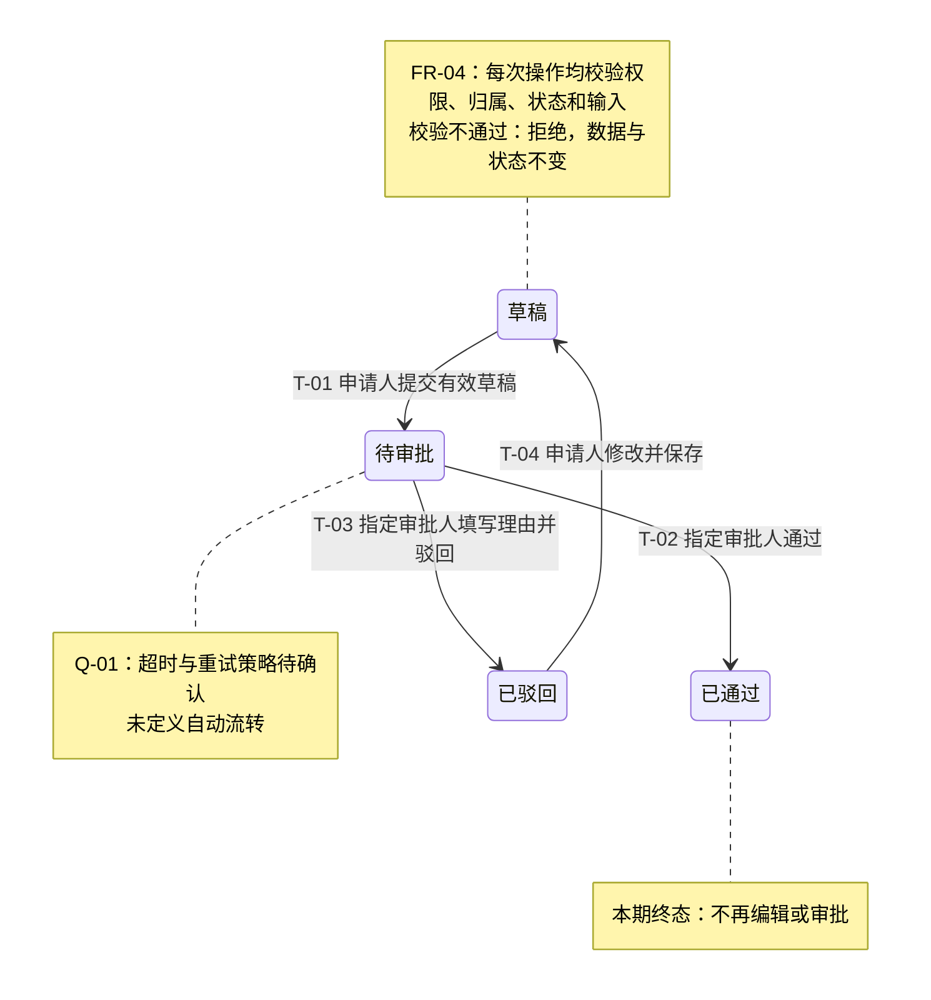
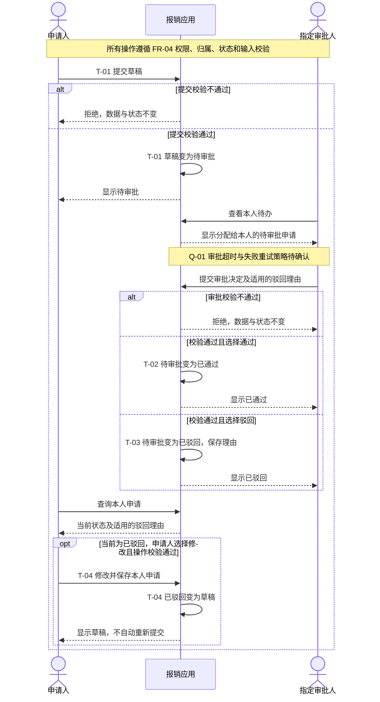

# 合成案例：报销申请的状态图与时序图

本例全部输入和业务规则均为**虚构教学材料**，不是系统实查、产品批准或测试通过的记录。用户只要 Mermaid 图和对应说明，不生成 PRD 或 PDF。两图分别回答“申请处于什么状态”和“谁先做什么”，不是同一流程重复画两遍。

## 完整输入

> `$read-her-heart` 请把下面的报销申请规则整理成 Mermaid 状态图和时序图，用 Markdown 输出，并关联功能点和验收标准。只做逻辑说明，不评估做不做，不访问系统。
>
> 这是从 0 到 1 的内部报销工具。材料版本为 `EXP-01 v1.0`，以下规则已由本轮输入明确；系统尚未实现。申请已经创建为“草稿”，本次不描述创建动作。
>
> - `FR-01 / AC-01`：有提交权限的申请人，只能提交自己的草稿。必填信息完整时提交成功，状态变为“待审批”，指定审批人可在待办中查看；字段缺失则拒绝，草稿不变。
> - `FR-02 / AC-02、AC-03`：只有该申请的指定审批人可处理“待审批”申请。选择通过后变为“已通过”；选择驳回并填写理由后变为“已驳回”，理由可供申请人查看。无驳回理由则拒绝，仍为待审批。申请人可查询当前状态。“已通过”在本期范围内不可再次编辑或审批。
> - `FR-03 / AC-04`：申请人可修改自己的已驳回申请，保存后回到草稿；以后重新提交仍走 `FR-01`，不自动重提。
> - `FR-04 / AC-05`：所有修改状态的请求都校验角色、申请归属、当前状态和该动作的输入条件。不符合时拒绝，申请数据与状态不变；查看仅限申请人本人或指定审批人。本文不指定错误提示文案。
> - `Q-01`：审批超时如何处理、失败后是否重试尚未决定，不要默认自动通过、自动驳回或补造重试次数、接口和架构。

## 图 1：申请生命周期

图 ID：`EXP-01-STATE-01`；依据：`EXP-01 v1.0`；状态：**拟建系统规则示意，非现网观察**。起点为已有草稿，箭头只表示输入中明确的业务状态变化；`T-01`～`T-04` 与下方验收映射共用。

## 图 2：提交、审批与返修交互

图 ID：`EXP-01-SEQ-01`；依据与状态同图 1。参与者是业务角色与逻辑应用，不代表服务拆分或某种通信协议；`App` 不隐含数据库、消息队列或具体 API。

时序图中的 `opt` 只展示满足全部条件的返修路径；返修请求不合法时仍按 `FR-04` 拒绝且不改数据，不存在绕过校验的隐含分支。两图均未把 Q-01 画成确定的状态或消息。

## 规则与 QA 映射

表中预期来自输入，供 QA 编写用例，不表示已执行测试；条件和结果不依赖 Mermaid 是否能渲染。图中的只读查询与结果展示沿用 `FR-01/FR-02`，同时受 `FR-04` 可见性约束。

| 两图中的事件/分支 | 功能与验收 | 可判定条件与结果 |
| --- | --- | --- |
| T-01；待办与提交结果展示 | FR-01 / AC-01 | 有权限的申请人提交本人草稿且必填完整 → 状态待审批，指定审批人在本人待办可见；缺必填 → 拒绝，草稿及数据不变 |
| T-02；申请人查询结果 | FR-02 / AC-02 | 指定审批人对待审批申请选择通过 → 已通过，申请人查询到该状态；后续编辑或再次审批被拒，数据及状态不变 |
| T-03；理由展示 | FR-02 / AC-03 | 指定审批人对待审批申请填写理由并驳回 → 已驳回，申请人可查看理由；未填理由 → 拒绝，保持待审批且不改申请数据 |
| T-04；返修 `opt` | FR-03 / AC-04 | 申请人修改并保存本人已驳回申请且校验通过 → 草稿；不自动转待审批，重新提交另按 T-01 判定 |
| 两图的校验说明与拒绝分支 | FR-04 / AC-05 | 无操作权限、非本人/非指定审批人、状态不允许或输入不合格 → 拒绝，数据与状态不变；其他人员不能查看该申请及理由 |
| Q-01 | 待确认；涉及 FR-02 与相应 AC | 超时后的状态、可操作动作及重试结果未定义；对应场景 **QA 编写受阻**，需产品与研发确认，不从图的箭头推定规则 |

这两张图可作为同一版本方案的不同视图；以后修改某条转换或交互时，应同时检查相关图、FR 和 AC，而不是只改箭头。用户只请求一类图时，输出对应视图即可。
